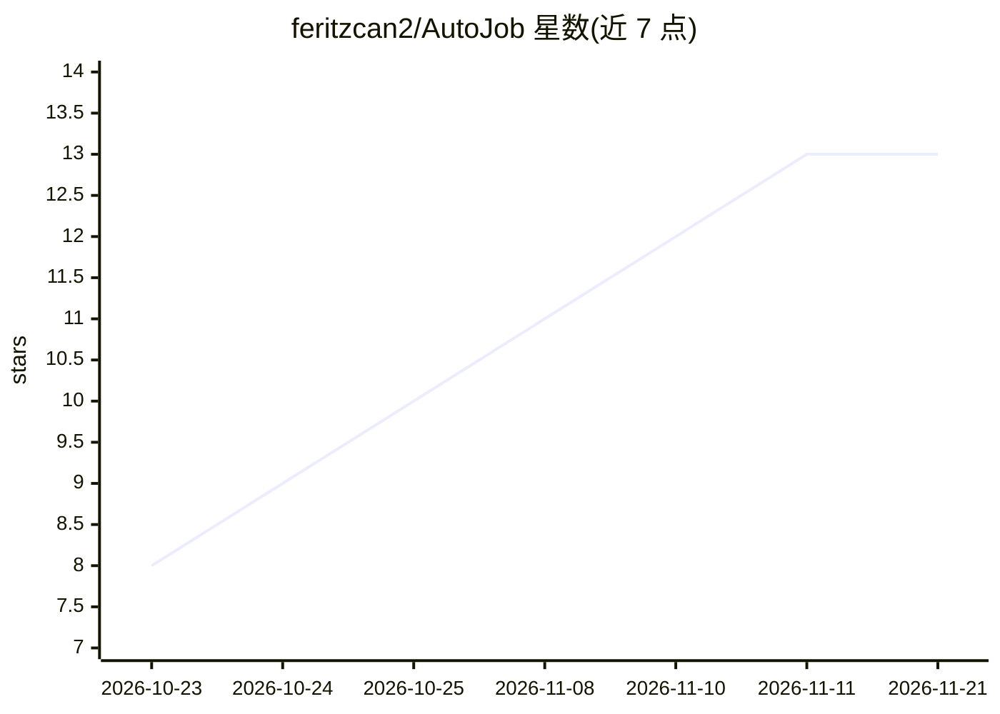

# feritzcan2/AutoJob

⭐ 13 · JavaScript · NOASSERTION · 推送 2026-11-20 · [GitHub](https://github.com/feritzcan2/AutoJob) · [官网](https://feritzcan2.github.io/AutoJob/) · 个人维护

**求职者桌面应用：抓取职位、评分匹配并自动投递**

开源桌面求职助手：按设定条件定期抓取 LinkedIn、Indeed、StepStone 等 25+ 招聘站点，将职位与用户 CV 比对打分并给出理由，自动填写申请表、上传简历并提交，为每个职位生成求职信，可在 LinkedIn 上向招聘者发送经批准的联系人消息。通过 Chrome 在真实站点上操作，遇登录/CAPTCHA 暂停交还用户。数据本地存储，无自有账号与服务器。本身免费，AI 用量计入用户自有订阅；另提供商业许可选项。

## 筛选速览

| 维度 | 判定 | 备注 |
|---|---|---|
| AI 角色 | `ai-native` | 本体是模型或模型工具 |
| 许可风险 | `none` | NOASSERTION |
| 部署形态 | `desktop` | 安装包/桌面程序 |
| 模型依赖 | — | README 未给出锁定关系 |
| 硬件要求 | — | 无带数字的原话,不猜 |
| 安装摩擦 | `low` | 无编译、无系统依赖或容器化 |
| 成熟度 | — | 结构信号不足 |

## 能力要点

- 对 LinkedIn/Indeed/StepStone/XING 等 25+ 站点的定时抓取，含公开 API、直读与自有 Chrome 三种读取方式
- 职位与 CV 比对评分并给出匹配理由，按规则过滤不符职位
- 自动填表、注册账号、提交申请，缺项询问一次后记忆
- Telegram 更新通知与应用状态跟踪表

## 适用场景

- 长期求职期间自动汇总多个招聘站点的职位
- 为每个申请生成个性化求职信并审批后发送
- 在 LinkedIn 上自动查找并联系招聘负责人

## 场景标签

`网页抓取` `浏览器自动化` `AI 写作` · 领域:效率与自动化

## 证据(README 行号)

> L27: cover letter. AutoJob is an open-source AI job search app for your desktop that does
> L135: AutoJob uses the AI assistant you already have. Install one of these and sign in

## 星数曲线

2026-10-23 8 → 2026-11-21 13（+5）

---
*卡片 v1 · prompt 1.4 · 生成 2026-11-18 · 置信度 high · 依据 README sha `4040d7ff4c4c` · [字段定义](../../DATASET.md)*
