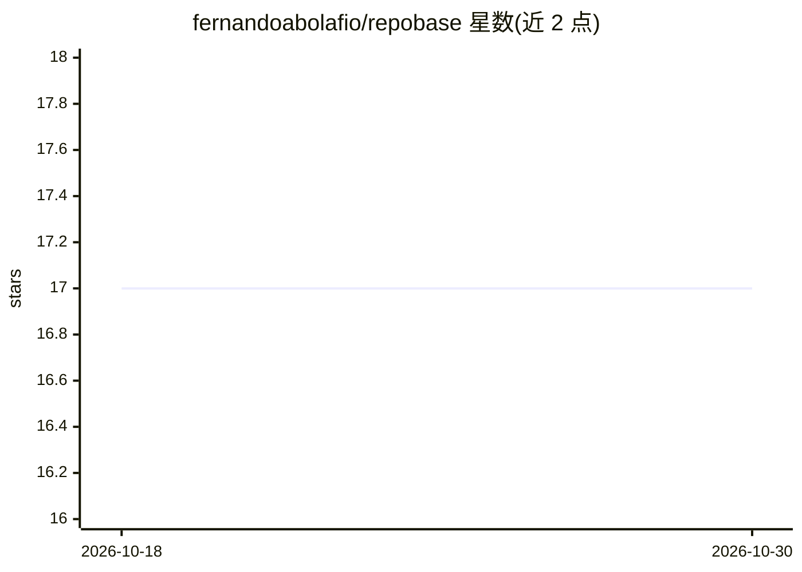

# fernandoabolafio/repobase

⭐ 17 · TypeScript · MIT · 推送 2026-01-31 · [GitHub](https://github.com/fernandoabolafio/repobase) · [官网](https://repobase.dev) · 个人维护

**Git 仓库索引与搜索工具，供 AI 工具通过 MCP 调用**

对本地 Git 仓库建立索引并提供关键词、语义与混合三种搜索模式的命令行工具，包含终端 UI（添加/删除/同步仓库、快捷键操作）与 MCP server 两部分。MCP server 向 Cursor、Claude 等 AI 工具暴露 list_repos、search、read_file、grep 等七个工具，使 AI 客户端能够检索和读取代码仓库内容。以 npm 包分发，运行需要 Bun 运行时，代码组织为 engine/tui/mcp-server 三个包。

## 筛选速览

| 维度 | 判定 | 备注 |
|---|---|---|
| AI 角色 | `ai-ecosystem` | LLM/agent 周边工具 |
| 许可风险 | `permissive` | MIT |
| 部署形态 | `library` | 以包/库形式分发 |
| 模型依赖 | — | README 未给出锁定关系 |
| 硬件要求 | — | 无带数字的原话,不猜 |
| 安装摩擦 | `low` | 无编译、无系统依赖或容器化 |
| 成熟度 | — | 结构信号不足 |

## 能力要点

- 支持关键词、语义、混合三种搜索模式
- MCP server 暴露 search/read_file/grep/glob 等 7 个工具供 AI 工具调用
- 终端 UI 支持仓库添加、同步与搜索的快捷键操作
- monorepo 结构：engine/tui/mcp-server 三包

## 适用场景

- 让 Cursor/Claude 等 AI 工具检索和读取我的本地代码仓库
- 在终端集中管理和同步多个 Git 仓库的索引
- 跨多个代码仓库做关键词或语义搜索

## 场景标签

`语义搜索` · 领域:知识与检索

## 证据(README 行号)

> L10: Index and search your Git repositories with AI. Includes a terminal UI and MCP server for AI tool integration.
> L41: ### MCP Server (Cursor, Claude, etc.)
> L55: - `search` - Search across repositories (keyword, semantic, or hybrid mode)

## 星数曲线

2026-10-18 17 → 2026-10-30 17（+0）

---
*卡片 v1 · prompt 1.4 · 生成 2026-10-30 · 置信度 high · 依据 README sha `d9e939b98a7a` · [字段定义](../../DATASET.md)*
