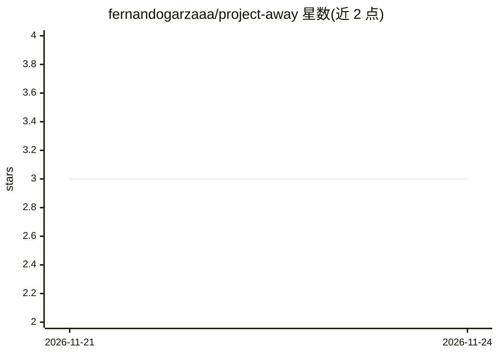

# fernandogarzaaa/project-away

⭐ 3 · Python · MIT · 推送 2026-10-25 · [GitHub](https://github.com/fernandogarzaaa/project-away) · 个人维护

**免手动本地 PC 控制：手势移光标、语音打字、人脸门控**

面向普通用户的 Windows 桌面应用，用摄像头和麦克风实现免手动电脑操作：食指点动控制光标、捏合点击、语音持续监听并打字（含口述标点、'scratch that' 撤销修正），并检测用户是否注视屏幕作为门控。v0.1.20 起可与已有 AI agent（Claude、ChatGPT、Cursor 等）协作，用点赞手势回答提问、通知任务完成。安装包首次运行额外下载约 1.6 GB 语音与追踪模型，可断点续传；提供 Gesture Studio 用 15 次示范训练自定义手势，支持区域忽略规则。数据默认本地处理。

## 筛选速览

| 维度 | 判定 | 备注 |
|---|---|---|
| AI 角色 | `ai-native` | 本体是模型或模型工具 |
| 许可风险 | `permissive` | MIT |
| 部署形态 | `desktop` | 安装包/桌面程序 |
| 模型依赖 | local-ok | 支持本地模型 |
| 硬件要求 | — | 无带数字的原话,不猜 |
| 安装摩擦 | `medium` | 含编译或系统依赖之一 |
| 成熟度 | — | 结构信号不足 |

## 能力要点

- 手势控制光标：指向移动、捏合点击/拖拽、双指滚动、掌心滑动式触控板滚动、自动滚动
- 语音持续听写：口述标点、'scratch that'/'no wait' 修正、可选 LLM 智能清理
- Gesture Studio 自定义手势训练：15 次示范学习、区域忽略、错误样本反馈
- 本地优先：除连接 agent 并按 Allow 外数据不离开本机

## 适用场景

- 手臂不便或离开键盘时免手动操作电脑
- 演示幻灯片/浏览照片时用手势与语音控制
- 与已有 AI agent 配合，用手势快速确认提问并接收完成通知

## 场景标签

`GUI 自动化` `语音识别` · 领域:效率与自动化

## 证据(README 行号)

> L7: Project Away sees your gestures, notices whether you are at the screen and paying attention, and listens for your
> L8: voice. You use that to run your PC hands-free (point to move the cursor, pinch to click, talk to type), and, new in
> L152: Voice is always listening by default. Just talk, and your words are typed wherever the text cursor is.

## 星数曲线

2026-11-21 3 → 2026-11-24 3（+0）

---
*卡片 v1 · prompt 1.4 · 生成 2026-11-22 · 置信度 mid · 依据 README sha `cc356f0924b8` · [字段定义](../../DATASET.md)*
