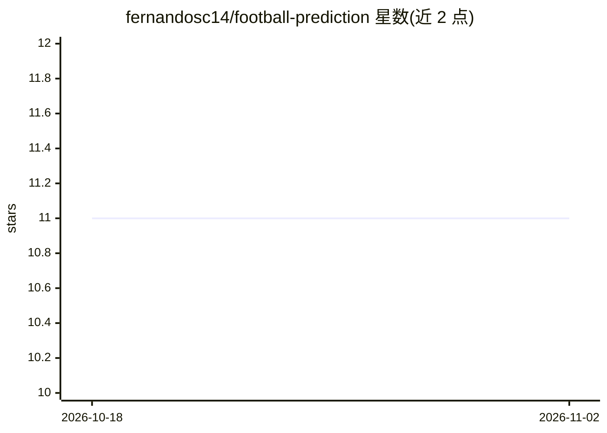

# fernandosc14/football-prediction

⭐ 11 · Python · MIT · 推送 2025-12-20 · [GitHub](https://github.com/fernandosc14/football-prediction) · [官网](https://football-prediction-murex.vercel.app) · 个人维护

**用机器学习预测足球比赛结果的 Web 平台**

面向足球赛事预测的全栈平台：后端基于 Python/FastAPI，前端使用 Next.js 与 Tailwind CSS。机器学习模型结合实时数据，输出比赛胜负、双重机会、大小球、双方进球等预测及置信度；支持自动数据抓取与模型训练、REST API 集成、通过云自动化定时更新。安装方式为 git clone 源码后分别安装 Python 与前端依赖并配置环境变量运行，v1.0.0 声明为稳定生产就绪配置。

## 筛选速览

| 维度 | 判定 | 备注 |
|---|---|---|
| AI 角色 | `ai-native` | 本体是模型或模型工具 |
| 许可风险 | `permissive` | MIT |
| 部署形态 | `library` | 以包/库形式分发 |
| 模型依赖 | — | README 未给出锁定关系 |
| 硬件要求 | — | 无带数字的原话,不猜 |
| 安装摩擦 | `low` | 无编译、无系统依赖或容器化 |
| 成熟度 | — | 结构信号不足 |

## 能力要点

- 预测比赛结果、双重机会、大小球与 BTTS 并给出置信度
- 自动数据抓取与模型训练，REST API 供集成查询
- 通过云自动化执行定时更新（周更脚本）

## 适用场景

- 查看主流足球联赛的比赛结果预测与置信度
- 通过 REST API 获取预测数据做自定义查询或集成
- 运行周更脚本保持数据与模型更新

## 场景标签

 · 领域:体育数据/预测分析

## 证据(README 行号)

> L14: Football Prediction is a modern, data-driven platform for forecasting football match outcomes.
> L18: - Predict match results, double chance, over/under goals, and BTTS.

## 星数曲线

2026-10-18 11 → 2026-11-02 11（+0）

---
*卡片 v1 · prompt 1.4 · 生成 2026-11-02 · 置信度 mid · 依据 README sha `91f8bf77f6c5` · [字段定义](../../DATASET.md)*
