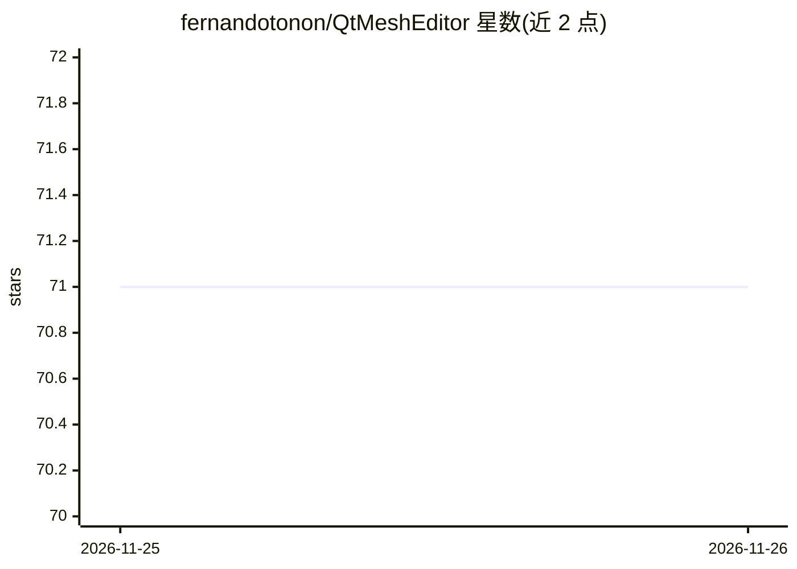

# fernandotonon/QtMeshEditor

⭐ 71 · C++ · MIT · 推送 2026-11-25 · [GitHub](https://github.com/fernandotonon/QtMeshEditor) · [官网](http://editor.qtmesh.dev/) · 个人维护

**独立游戏开发者的 3D 资产工具：格式转换、动画合并、材质编辑**

面向独立游戏开发者的桌面 3D 资产处理工具，提供 GUI、CLI（qtmesh）与 GitHub Actions 三种使用方式。功能覆盖 40+ 格式互转、Mixamo 动画合并与重采样、LOD 生成、PBR 纹理绘制与烘焙、骨骼检查等；AI 部分包括材质辅助生成、部件分割、本地 LLM agent 模式、57+ 工具的 MCP server 与 REST API。可通过 winget/brew/snap/flatpak 安装，另提供 QtMesh Cloud 上传与徽章服务。

## 筛选速览

| 维度 | 判定 | 备注 |
|---|---|---|
| AI 角色 | `ai-enhanced` | 去掉 AI 部分产品仍成立 |
| 许可风险 | `permissive` | MIT |
| 部署形态 | `desktop` | 安装包/桌面程序 |
| 模型依赖 | — | README 未给出锁定关系 |
| 硬件要求 | — | 无带数字的原话,不猜 |
| 安装摩擦 | `low` | 无编译、无系统依赖或容器化 |
| 成熟度 | — | 结构信号不足 |

## 能力要点

- 40+ 3D 格式转换与 Mixamo 动画合并导出
- ZBrush 式顶点/纹理绘制，PBR 通道烘焙并按 Unity/Unreal 布局重打包
- MCP server 提供 57+ 工具供 Claude、Cursor 等 agent 调用
- 文本生成动作（本地运行 Kimodo + Llama 3）与音频驱动口型同步（Audio2Face-3D ONNX）

## 适用场景

- 把 Mixamo 下载的多个动画合并进角色模型后导出 glTF/FBX
- 在 CI 中批量扫描校验游戏资产命名与复杂度
- 用 AI 分割角色部件并拆分为子网格
- 通过自然语言让本地 agent 代为执行编辑器操作

## 场景标签

 · 领域:游戏开发/3D 图形工具

## 证据(README 行号)

> L3: Automate your 3D asset pipeline — scan, validate, convert, fix, and merge 3D assets with GUI + CLI + CI/CD support.
> L196: - **Material editor** — visual editing with AI-assisted generation; PBR + HDR/IBL materials look correct on first 
> L203: - **AI agent** — describe a task in natural language; a local LLM plans it over the editor's tools, runs it step b

## 星数曲线

2026-11-25 71 → 2026-11-26 71（+0）

---
*卡片 v1 · prompt 1.4 · 生成 2026-11-24 · 置信度 mid · 依据 README sha `4981b982c139` · [字段定义](../../DATASET.md)*
