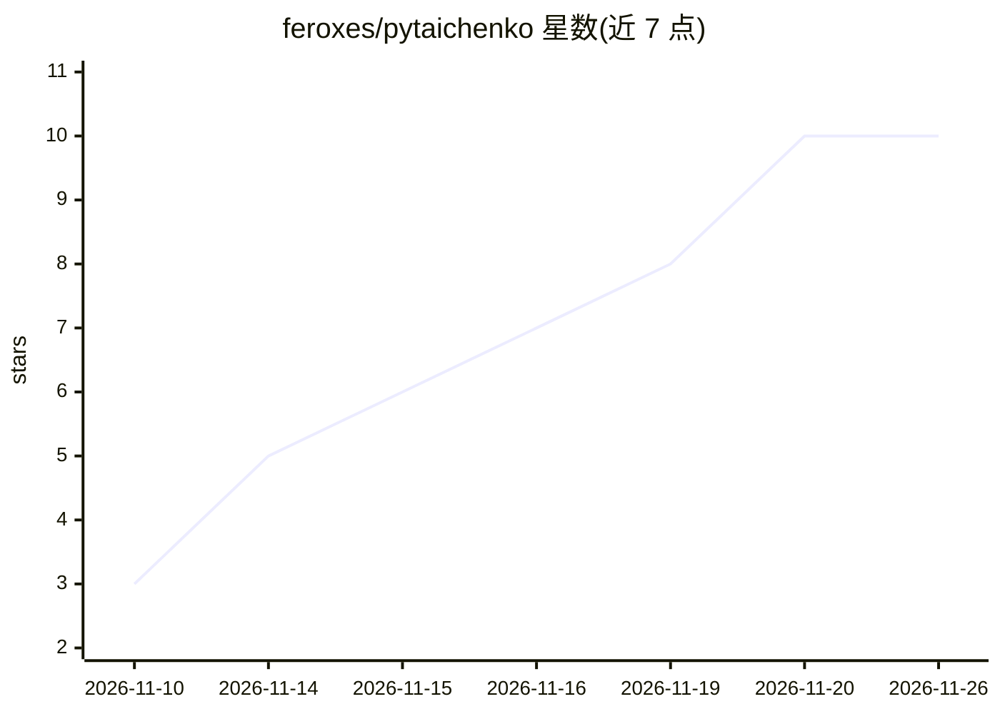

# feroxes/pytaichenko

⭐ 10 · JavaScript · MIT · 推送 2026-11-13 · [GitHub](https://github.com/feroxes/pytaichenko) · [官网](https://feroxes.github.io/pytaichenko/) · 个人维护

**自制 ESP32-S3 AI 语音音箱：本地唤醒词+OpenAI Realtime 对话**

开源硬件 DIY 项目：提供 3D 打印外壳、图文分步焊接组装指南和固件。版本 2 基于 ESP32-S3，板上用 microWakeWord 模型识别唤醒词，语音直连 OpenAI Realtime API 或 GPT-Live，音箱自身保管 API key；版本 1 基于 ESP32，通过家庭服务器上的 voice-hub Docker 服务代理对话。固件经浏览器 USB 安装，版本 2 支持设置页 OTA 升级；设置页支持中英/乌克兰双语，配置 key、模型、音色与唤醒词。需自备 OpenAI API key，对话按 OpenAI 价格付费。

## 筛选速览

| 维度 | 判定 | 备注 |
|---|---|---|
| AI 角色 | `ai-native` | 本体是模型或模型工具 |
| 许可风险 | `permissive` | MIT |
| 部署形态 | `desktop` | 安装包/桌面程序 |
| 模型依赖 | — | README 未给出锁定关系 |
| 硬件要求 | — | 无带数字的原话,不猜 |
| 安装摩擦 | `low` | 无编译、无系统依赖或容器化 |
| 成熟度 | — | 结构信号不足 |

## 能力要点

- 板上识别唤醒词（Hey Jarvis/Okay Nabu/Hey Mycroft），未唤醒时不外传声音
- 版本 2 固件浏览器 USB 安装，后续从设置页 OTA 升级
- 双版本架构：全自包含 ESP32-S3 或 Docker voice-hub 家庭服务器
- 代码 MIT、外壳与指南 CC BY-SA 4.0，附 STL 与固件发布包

## 适用场景

- 自己动手组装一台唤醒词语音对话音箱
- 给家里做一套本地唤醒、不常驻上传音频的语音助手
- 作为 ESP32-S3 + OpenAI Realtime 的参考硬件项目学习

## 场景标签

`语音 Agent` · 领域:对话与助手

## 证据(README 行号)

> L7:  A voice speaker you build yourself: it hears its wake phrase on the board and holds the conversation with the OpenA
> L18: **Version 2** talks with OpenAI by itself. It is built on an ESP32-S3 board, and the speaker serves its own setting

## 星数曲线

2026-11-10 3 → 2026-11-26 10（+7）

---
*卡片 v1 · prompt 1.4 · 生成 2026-11-20 · 置信度 high · 依据 README sha `572cab93a3db` · [字段定义](../../DATASET.md)*
