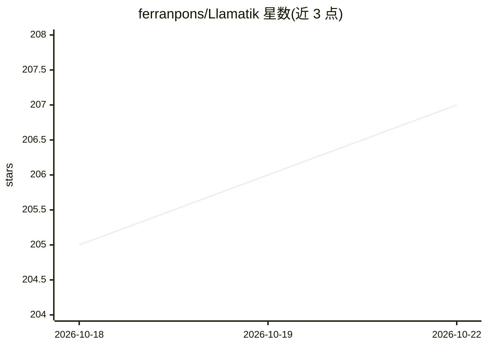

# ferranpons/Llamatik

⭐ 207 · Kotlin · MIT · 推送 2026-10-20 · [GitHub](https://github.com/ferranpons/Llamatik) · [官网](https://www.llamatik.com) · 个人维护

**Kotlin 跨平台端侧 AI SDK：本地 LLM/STT/图像生成与 Agent 框架**

面向 Kotlin Multiplatform 开发者的端侧 AI SDK，覆盖 Android、iOS、桌面 JVM 与 WASM。core 模块通过 Kotlin/Native 与 JNI 绑定 llama.cpp（LLM 推理，含 schema 约束 JSON、多模态、并发会话）、whisper.cpp（离线语音转写）、stable-diffusion.cpp（txt2img/img2img）；sdk 模块提供 Chat、模型管理、RAG 向量存储、Assistant 门面与 Agent DSL（内存、工具、工作流）；sdk-agent 提供 AgentRuntime、权限、审计与 9 个平台工具。默认完全离线，可选远程推理。通过 Maven Central 以 Gradle 依赖安装，iOS 目标需 16.6+、Android MinSDK 26、JVM 21+。

## 筛选速览

| 维度 | 判定 | 备注 |
|---|---|---|
| AI 角色 | `ai-ecosystem` | LLM/agent 周边工具 |
| 许可风险 | `permissive` | MIT |
| 部署形态 | `None` |  |
| 模型依赖 | local-ok | 支持本地模型 |
| 硬件要求 | — | 无带数字的原话,不猜 |
| 安装摩擦 | `high` | 编译与系统依赖俱全 |
| 成熟度 | — | 结构信号不足 |

## 能力要点

- 统一 Kotlin API 绑定 llama.cpp/whisper.cpp/stable-diffusion.cpp 三类端侧推理
- Agent 框架 DSL：流式输出、多种内存类型、工具注册与工作流
- AgentPlatform 的 AgentRuntime 含权限→确认→执行→审计管线与 9 个内置平台工具
- schema 约束 JSON 生成、VLM 多模态、KV cache 会话与并发会话

## 适用场景

- 在 Android/iOS/桌面应用中集成离线 LLM 聊天与语音转写
- 构建本地 RAG 或混合在线回退的 AI 应用
- 用 Kotlin DSL 构建带工具调用与权限控制的端侧 Agent

## 场景标签

`Agent 框架` `图像生成` `RAG` `语音识别` · 领域:Agent 开发

## 证据(README 行号)

> L79: **Llamatik** is a Kotlin Multiplatform AI SDK that covers the full stack — from low-level on-device inference to hi
> L83: - 🔬 **Inference Library** (`com.llamatik:core`) — direct Kotlin bindings to the best open-source native inference e
> L90: No Python.

## 星数曲线

2026-10-18 205 → 2026-10-22 207（+2）

---
*卡片 v1 · prompt 1.4 · 生成 2026-10-22 · 置信度 high · 依据 README sha `24c5a90e78c6` · [字段定义](../../DATASET.md)*
