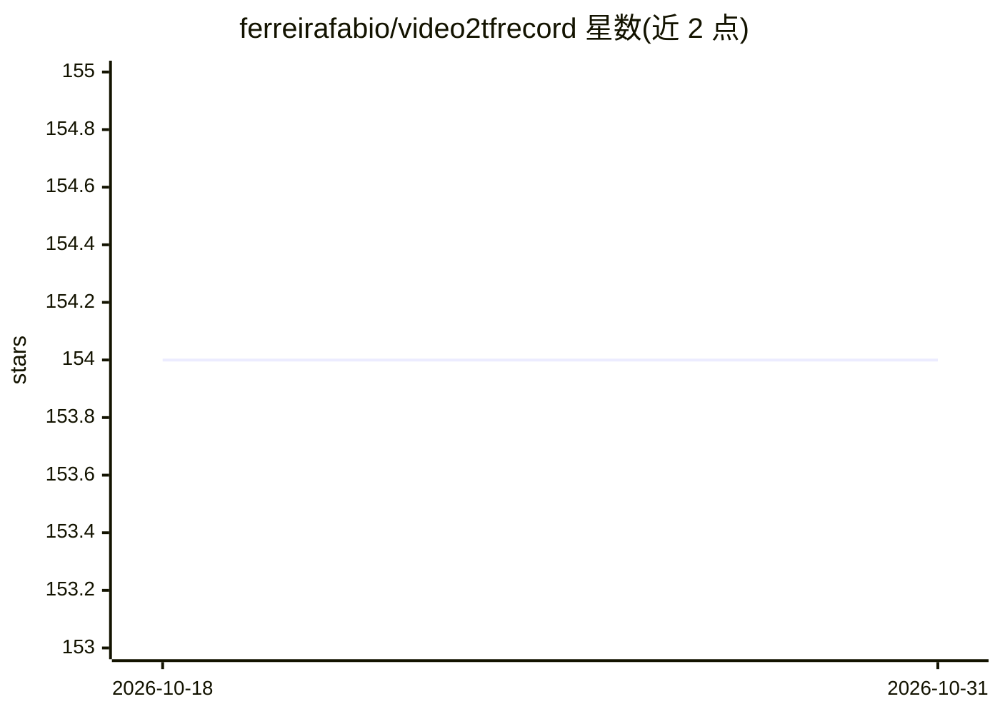

# ferreirafabio/video2tfrecord

⭐ 154 · Python · MIT · 推送 2026-02-09 · [GitHub](https://github.com/ferreirafabio/video2tfrecord) · 个人维护

**将 RGB 视频转换为 TFRecord 训练数据格式的预处理工具**

Python 包，把 .avi/.mp4 等 RGB 视频转写为 TensorFlow 的 TFRecord 文件，供神经网络训练使用。核心机制：可限制每个视频存储的帧数（应对 GPU 显存限制），自动计算帧步长使保留帧均匀分布；可选将 OpenCV Farneback 光流作为第 4 通道写入。可配置分辨率、颜色深度、每个 TFRecord 的视频数。README 声明代码源于科研项目且历史演进而来，邀请用户提 PR 修复 bug；测试环境为 Python 3.4-3.6、TensorFlow 1.5.0、OpenCV 3.4.0.12。示例文件需用 GitHub 仓库而非 pip 包获取。

## 筛选速览

| 维度 | 判定 | 备注 |
|---|---|---|
| AI 角色 | `ai-ecosystem` | LLM/agent 周边工具 |
| 许可风险 | `permissive` | MIT |
| 部署形态 | `library` | 以包/库形式分发 |
| 模型依赖 | — | README 未给出锁定关系 |
| 硬件要求 | — | 无带数字的原话,不猜 |
| 安装摩擦 | `low` | 无编译、无系统依赖或容器化 |
| 成熟度 | — | 结构信号不足 |

## 能力要点

- 限制每视频帧数并自动均匀选取帧步长
- 可附加 Farneback 光流作为第 4 通道
- 可配置分辨率、颜色深度、每 TFRecord 视频数
- 支持 n_frames_per_video='all' 存储全部帧

## 适用场景

- 把视频数据集转成 TFRecord 喂给 TensorFlow 训练
- 在显存受限时只保留均匀采样的部分帧
- 为训练数据加入光流通道

## 场景标签

 · 领域:机器学习数据预处理/视频

## 证据(README 行号)

> L4: Easily convert RGB video data (e.g. tested with .avi and .mp4) to the TensorFlow tfrecords file format for training 
> L6: The implementation offers the option to include Optical Flow (currently OpenCV's calcOpticalFlowFarneback) as an add

## 星数曲线

2026-10-18 154 → 2026-10-31 154（+0）

---
*卡片 v1 · prompt 1.4 · 生成 2026-10-22 · 置信度 high · 依据 README sha `dc388d6abfea` · [字段定义](../../DATASET.md)*
