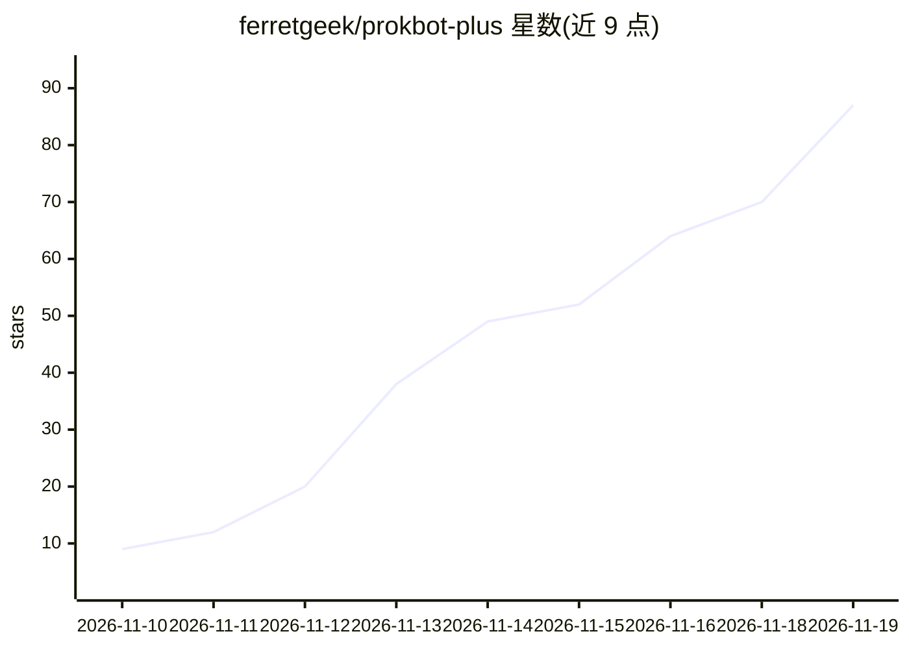

# ferretgeek/prokbot-plus

⭐ 87 · JavaScript · NOASSERTION · 推送 2026-11-18 · [GitHub](https://github.com/ferretgeek/prokbot-plus) · 个人维护 · 中文 README

**自托管运行 Grok Bot 的服务端与客户端补丁，模型自选**

在开源项目 ProkBot 基础上扩展的自托管方案：用 Docker 在自己的 Linux 服务器（x86_64/ARM64）上运行 Grok Bot 的 Host 服务端与 Bot 专用 Linux 电脑，并对官方 Windows/macOS/iOS 客户端打补丁，另提供自开发的 Android App（非官方）。支持 OpenAI Chat、OpenAI Responses、Anthropic Messages 三种模型接口，可按 Bot 配置主模型、思考强度与备用模型顺序，模型推理走外部 API、服务器无需显卡。面向个人/家庭用户，模型与计费自行掌控，数据存本地；客户端版本固定、需自行部署维护，非商业许可，与 xAI 无关联。

## 筛选速览

| 维度 | 判定 | 备注 |
|---|---|---|
| AI 角色 | `ai-native` | 本体是模型或模型工具 |
| 许可风险 | `none` | NOASSERTION |
| 部署形态 | `self-host` | docker 或自建部署 |
| 模型依赖 | locked-api |  |
| 硬件要求 | — | 无带数字的原话,不猜 |
| 安装摩擦 | `low` | 无编译、无系统依赖或容器化 |
| 成熟度 | — | 结构信号不足 |

## 能力要点

- 服务端 Docker 化自托管，模型推理走 API、服务器不需要显卡
- 支持 OpenAI Chat / OpenAI Responses / Anthropic Messages 三种接口，Bot 级模型路由与备用模型自动切换
- 新增 Windows 客户端补丁与自开发 Android App，Bot 可操作一台 Linux 桌面电脑并实时观看画面
- 提供一键部署/备份/升级工具和面向 AI 执行的部署手册（doctor → init → up → status）

## 适用场景

- 在自己服务器上运行 Grok Bot，模型和服务商自选、按自己的接口计费
- 让 Bot 在专属 Linux 电脑上跑命令、开浏览器、处理文件并远程观看
- 在手机上使用自托管 Bot：聊天、通知、查看 Bot 电脑画面

## 场景标签

`AI 助手` `GUI 自动化` · 领域:效率与自动化

## 证据(README 行号)

> L27: 开源项目 ProkBot 把服务端（Host 和 Bot 用的 Linux 电脑）用 Docker 搬到你自己的服务器上，再给原版客户端打补丁，让它连你的服务器。**ProkBot Plus** 在它的基础上：
> L38: - **用原版 Grok Bot。** 界面、Agent、工具调用、记忆、定时任务、操作审批都是原版的，只是服务端在你自己手里。
> L79: |模型接口|三种格式任选一种：Anthropic Messages、OpenAI Responses、OpenAI Chat Completions。模型要支持工具调用；想让 Bot 操作电脑，还要能看图片。|

## 星数曲线

2026-11-10 9 → 2026-11-19 87（+78）

---
*卡片 v1 · prompt 1.4 · 生成 2026-11-18 · 置信度 mid · 依据 README sha `71f3993e660b` · [字段定义](../../DATASET.md)*
