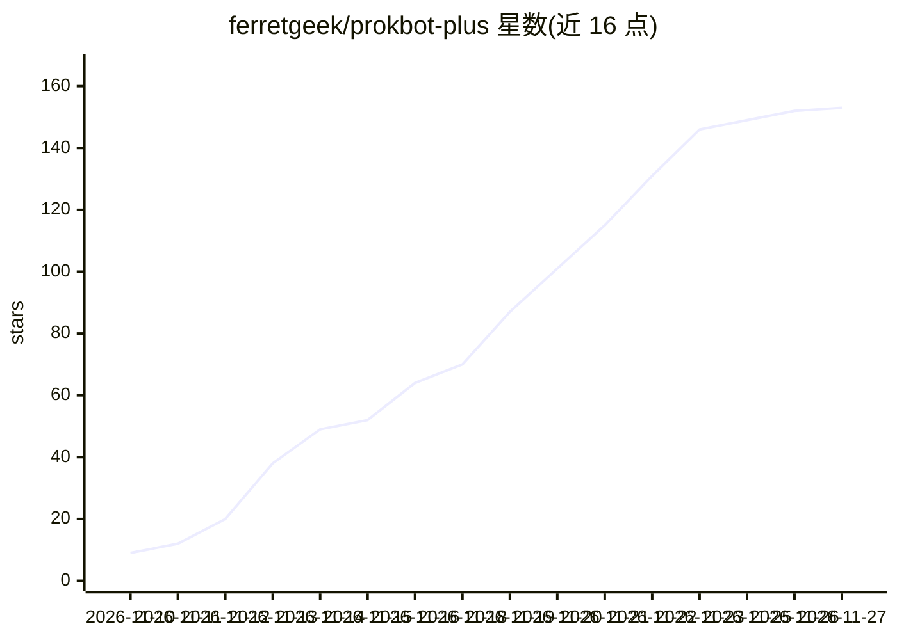

# ferretgeek/prokbot-plus

⭐ 153 · JavaScript · NOASSERTION · 推送 2026-11-26 · [GitHub](https://github.com/ferretgeek/prokbot-plus) · 个人维护 · 中文 README

**自托管 Grok Bot 服务端：用自己选的模型跑 AI 助手**

将 xAI 的 Grok Bot 服务端以 Docker 形式搬到用户自己的服务器上，并给官方客户端打补丁使其连到自建服务；Plus 版新增 Windows/Linux 桌面客户端、自开发 Android App 与网页版。模型通过 Anthropic Messages、OpenAI Responses、OpenAI Chat 三种接口接入，每个 Bot 可指定主模型、思考强度与备用模型。Bot 保留原版的 Linux 沙箱电脑（跑命令、开浏览器、处理文件）、记忆与定时任务，执行命令前需用户审批。服务器不需显卡，最低 2 核 4 GB；仅限非商业使用。

## 筛选速览

| 维度 | 判定 | 备注 |
|---|---|---|
| AI 角色 | `ai-ecosystem` | LLM/agent 周边工具 |
| 许可风险 | `none` | NOASSERTION |
| 部署形态 | `None` |  |
| 模型依赖 | locked-api |  |
| 硬件要求 | — | 无带数字的原话,不猜 |
| 安装摩擦 | `low` | 无编译、无系统依赖或容器化 |
| 成熟度 | — | 结构信号不足 |

## 能力要点

- 支持 Anthropic Messages、OpenAI Responses、OpenAI Chat 三种模型接口，每 Bot 可选主模型与备用模型
- Bot 附带自己的 Linux 电脑：跑命令、开浏览器、处理文件，带记忆与定时任务
- 提供 Windows、Linux（x64/ARM64）、Android App、网页版等多端客户端与 6 位配对码登录
- 一条命令完成检查、启动、升级、备份，并附 AI 可照做的部署手册

## 适用场景

- 在自家服务器上跑 AI 助手，数据不经过官方云端
- 用自己的 Anthropic/OpenAI 模型账号驱动 Bot 聊天与操作电脑
- 在局域网内让手机、平板、桌面多端连接同一个 Bot

## 场景标签

`AI 助手` · 领域:对话与助手

## 证据(README 行号)

> L35: ProkBot 把服务端用 Docker 搬到你自己的服务器上，再给官方客户端打补丁，让它连你的服务器。**ProkBot Plus** 在此基础上增加了：
> L38: - **更多模型接口**：Anthropic Messages、OpenAI Responses、OpenAI Chat 三种格式，可以给每个 Bot 指定主模型、思考强度和备用模型；

## 星数曲线

2026-11-10 9 → 2026-11-27 153（+144）

---
*卡片 v1 · prompt 1.4 · 生成 2026-11-27 · 置信度 mid · 依据 README sha `0c1344e22d5d` · [字段定义](../../DATASET.md)*
