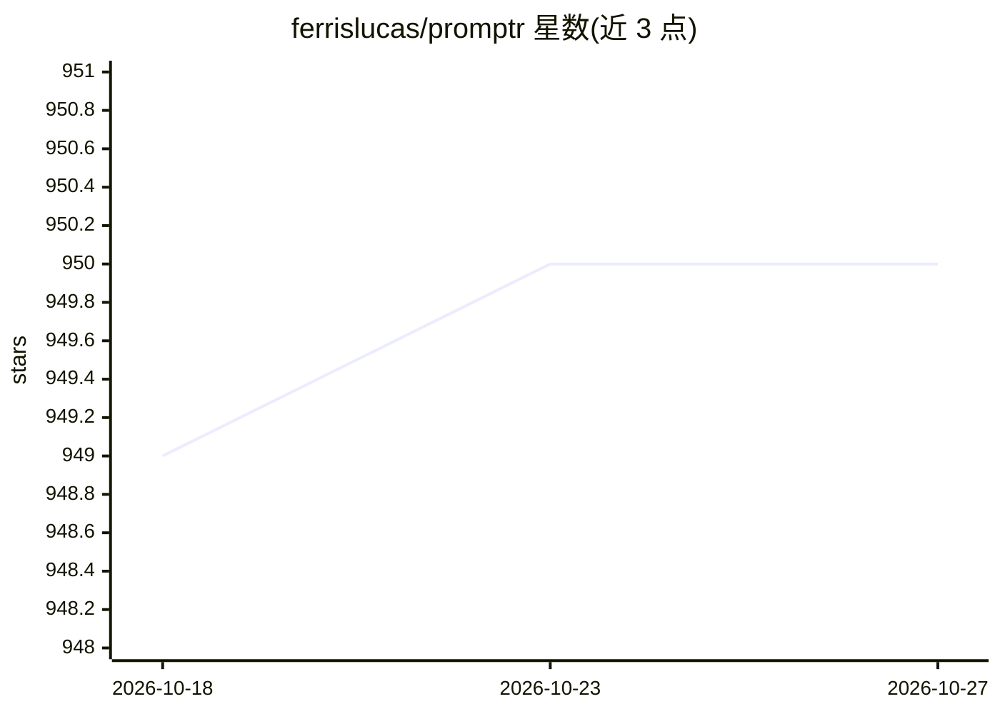

# ferrislucas/promptr

⭐ 950 · JavaScript · MIT · 推送 2026-04-24 · [GitHub](https://github.com/ferrislucas/promptr) · 个人维护

**用自然语言指令让 OpenAI 模型修改代码库的 CLI 工具**

命令行工具：用户以英文提示词下达指令，Promptr 将引用文件作为上下文发送给 OpenAI LLM 模型，解析模型输出并直接把代码变更写入文件系统。支持 liquidjs 模板与可复用的 include 片段，内置 refactor/swe/test-first 等模板，提供 dry-run 与交互模式。要求 Node 18、OpenAI API key 与计费设置；二进制安装目前仅支持 macOS，亦可经 npm/yarn 全局安装。MIT 许可。

## 筛选速览

| 维度 | 判定 | 备注 |
|---|---|---|
| AI 角色 | `ai-ecosystem` | LLM/agent 周边工具 |
| 许可风险 | `permissive` | MIT |
| 部署形态 | `library` | 以包/库形式分发 |
| 模型依赖 | — | README 未给出锁定关系 |
| 硬件要求 | — | 无带数字的原话,不猜 |
| 安装摩擦 | `low` | 无编译、无系统依赖或容器化 |
| 成熟度 | — | 结构信号不足 |

## 能力要点

- 模型输出的代码变更直接应用到引用文件
- liquidjs 模板系统与可复用 include 片段
- 内置 refactor/swe/test-first 等模板，支持 dry-run 与交互模式
- 通过 npm/yarn 全局安装，默认模型 gpt-4o

## 适用场景

- 用提示词驱动代码重构与修改
- 按项目编码标准批量生成或修改代码文件
- 实验不同提示词对代码生成结果的影响

## 场景标签

`代码生成` `提示工程` · 领域:Agent 开发

## 证据(README 行号)

> L3: Promptr is a CLI tool that lets you use plain English to instruct OpenAI LLM models to make changes to your codebase
> L15: Promptr will apply the model's code directly to your files. Use your favorite git UI to inspect the results.

## 星数曲线

2026-10-18 949 → 2026-10-27 950（+1）

---
*卡片 v1 · prompt 1.4 · 生成 2026-10-21 · 置信度 high · 依据 README sha `881ee0ef3668` · [字段定义](../../DATASET.md)*
