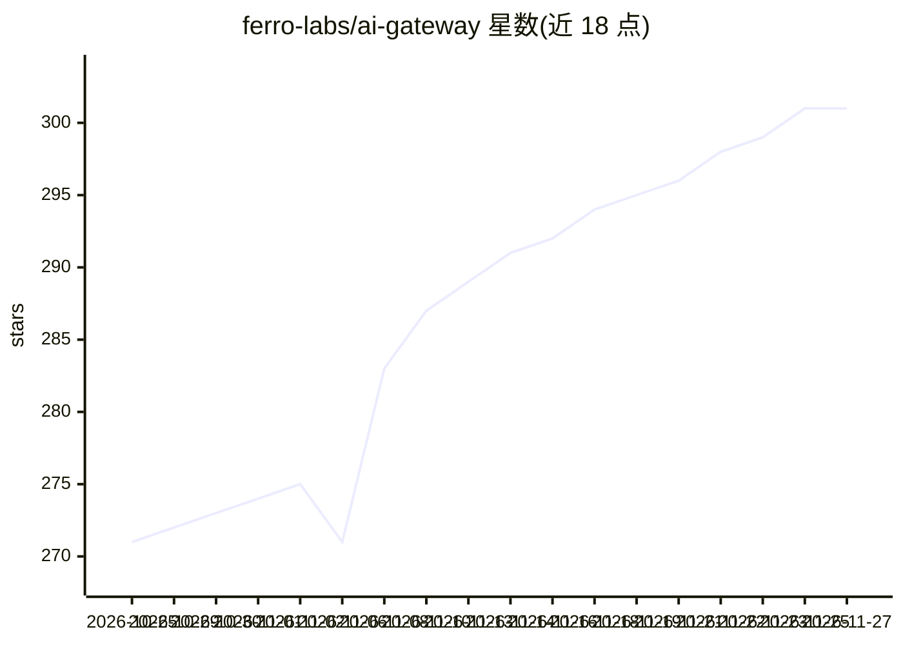

# ferro-labs/ai-gateway

⭐ 301 · Go · Apache-2.0 · 推送 2026-11-20 · [GitHub](https://github.com/ferro-labs/ai-gateway) · [官网](https://docs.ferrolabs.ai) · 组织维护

**Go 编写的开源 LLM 网关：统一 API 路由 30 家提供商**

以 Go 编写的 LLM 网关，通过单一 OpenAI 兼容 API 将请求路由到 30 家提供商、2500+ 模型，支持 8 种路由策略（fallback、负载均衡、成本优化、A/B 测试、条件路由等）、11 个内置护栏插件（PII 脱敏、密钥扫描、提示注入防护、速率限制等）、MCP 工具服务器接入、OpenTelemetry/Prometheus 可观测性，以及编译进二进制的运维控制台。提供单静态二进制、Docker、Homebrew/npm 等多种安装方式，配置由单个 YAML/JSON 文件驱动。面向需要统一管理 LLM 流量、成本与安全的开发者与运维团队。

## 筛选速览

| 维度 | 判定 | 备注 |
|---|---|---|
| AI 角色 | `ai-ecosystem` | LLM/agent 周边工具 |
| 许可风险 | `permissive` | Apache-2.0 |
| 部署形态 | `desktop` | 安装包/桌面程序 |
| 模型依赖 | — | README 未给出锁定关系 |
| 硬件要求 | — | 无带数字的原话,不猜 |
| 安装摩擦 | `low` | 无编译、无系统依赖或容器化 |
| 成熟度 | — | 结构信号不足 |

## 能力要点

- 单一 OpenAI 兼容 API 路由 30 家提供商、2500+ 模型
- 8 种路由策略（fallback/负载均衡/成本优化/A/B 测试/条件路由）
- 11 个内置护栏插件，插件框架公开可自写
- 内嵌运维控制台与 OpenTelemetry/Prometheus 可观测性，支持 MCP 工具服务器

## 适用场景

- 为多个 LLM 提供商提供统一入口并做故障切换
- 对 LLM 流量做成本控制与按 key 预算管理
- 通过护栏插件对请求响应做 PII 脱敏与提示注入防护
- 用 OpenTelemetry/Prometheus 追踪网关请求链路与开销

## 场景标签

`模型网关` · 领域:Agent 开发

## 证据(README 行号)

> L8: **High-performance AI gateway in Go. Route LLM requests across 30 providers via a single OpenAI-compatible API.**
> L110: |🔀 **Routing**|8 strategies — single, fallback, load balance, least latency, cost-optimized, content-based, A/B te
> L114: |🤖 **MCP**|Connects to stdio and Streamable HTTP tool servers, injects their tools into chat completions, and driv

## 星数曲线

2026-10-25 271 → 2026-11-27 301（+30）

---
*卡片 v1 · prompt 1.4 · 生成 2026-11-25 · 置信度 high · 依据 README sha `057b4568f35c` · [字段定义](../../DATASET.md)*
