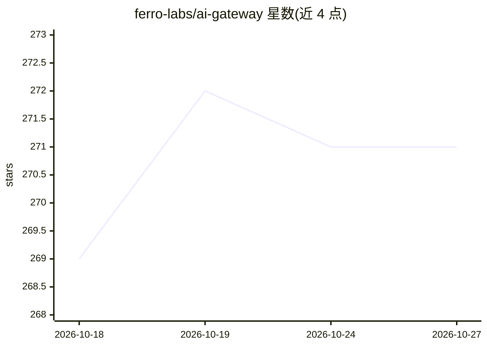

# ferro-labs/ai-gateway

⭐ 271 · Go · Apache-2.0 · 推送 2026-10-19 · [GitHub](https://github.com/ferro-labs/ai-gateway) · [官网](https://docs.ferrolabs.ai) · 组织维护 · 中文 README

**Go 编写的 OpenAI 兼容 LLM 网关：30 家提供商统一路由**

面向开发者和运维的单二进制 LLM 网关，用 Go 编写，将 30 家提供商、2,500+ 模型的请求经单一 OpenAI 兼容 API 路由，提供 8 种路由策略（fallback、负载均衡、成本优化、A/B 测试等）、11 个内置防护插件（PII 脱敏、提示注入防护、限流、预算等）、MCP 工具服务器接入、OpenTelemetry/Prometheus 可观测性与内嵌运维控制台。安装支持 curl 脚本、Homebrew、npm、Docker、deb/rpm/apk 包等；单二进制无需外部服务。

## 筛选速览

| 维度 | 判定 | 备注 |
|---|---|---|
| AI 角色 | `ai-ecosystem` | LLM/agent 周边工具 |
| 许可风险 | `permissive` | Apache-2.0 |
| 部署形态 | `desktop` | 安装包/桌面程序 |
| 模型依赖 | — | README 未给出锁定关系 |
| 硬件要求 | — | 无带数字的原话,不猜 |
| 安装摩擦 | `low` | 无编译、无系统依赖或容器化 |
| 成熟度 | — | 结构信号不足 |

## 能力要点

- 8 种路由策略，含 fallback、负载均衡、成本优化与 A/B 测试
- 11 个内置防护/治理插件并开放插件框架
- MCP stdio 与 Streamable HTTP 工具服务器接入并驱动 tool_calls 循环
- 单二进制内嵌运维控制台，含流量、花费、审计与配置回滚

## 适用场景

- 统一多家 LLM 提供商的接入与故障切换
- 对 LLM 流量做成本控制、限流与内容防护
- 为 LLM 服务接入 OpenTelemetry 追踪与 Prometheus 指标

## 场景标签

`模型网关` · 领域:Agent 开发

## 证据(README 行号)

> L8: **High-performance AI gateway in Go. Route LLM requests across 30 providers via a single OpenAI-compatible API.**
> L110: |🔀 **Routing**|8 strategies — single, fallback, load balance, least latency, cost-optimized, content-based, A/B te

## 星数曲线

2026-10-18 269 → 2026-10-27 271（+2）

---
*卡片 v1 · prompt 1.4 · 生成 2026-10-22 · 置信度 mid · 依据 README sha `2cb6f7385f2c` · [字段定义](../../DATASET.md)*
