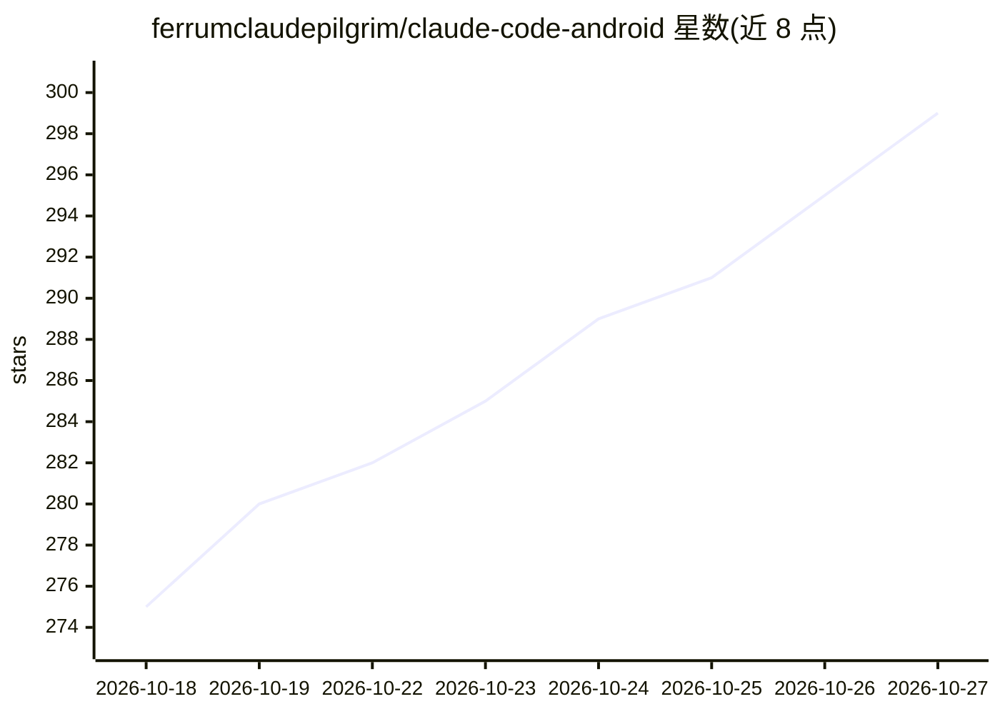

# ferrumclaudepilgrim/claude-code-android

⭐ 299 · Shell · MIT · 推送 2026-10-26 · [GitHub](https://github.com/ferrumclaudepilgrim/claude-code-android) · [官网](https://ferrumclaudepilgrim.com) · 个人维护

**在 Android 手机上原生运行 Claude Code 的安装指南与脚本**

提供三种在 Android 上运行 Claude Code 的安装路径：Path A 在 Termux 中下载官方 linux-arm64 二进制并打补丁使其可在 Android 上运行（含每日自动更新包装器）；Path B 通过 proot-distro 安装 Ubuntu 后用官方安装器安装；Path C 基于 Android 虚拟化框架运行 Debian 虚拟机（Pixel 6+、Android 16+，实验性）。要求 aarch64 设备、Android 8+ 与 Claude 账户。另附安全模型、agent 权限规则、SSRF 防护、指纹确认等文档。仓库本体是文档与安装脚本，不是 Claude Code 的替代实现。

## 筛选速览

| 维度 | 判定 | 备注 |
|---|---|---|
| AI 角色 | `ai-ecosystem` | LLM/agent 周边工具 |
| 许可风险 | `permissive` | MIT |
| 部署形态 | `desktop` | 安装包/桌面程序 |
| 模型依赖 | locked-api |  |
| 硬件要求 | — | 无带数字的原话,不猜 |
| 安装摩擦 | `low` | 无编译、无系统依赖或容器化 |
| 成熟度 | `idea` | |

## 能力要点

- 三种安装路径：Termux 补丁二进制 / proot Ubuntu / AVF Linux 虚拟机
- install.sh 下载官方 linux-arm64 二进制、校验 checksum 并打 ELF 补丁
- 每日自动检查更新的 claude 包装器（--update-now）
- 附带安全模型、agent 权限规则、SSRF 防护、指纹门禁等文档

## 适用场景

- 不带电脑时用 Android 手机直接跑 Claude Code 做编码
- 在 Pixel 设备上通过 AVF 虚拟机运行完整 Linux 环境的 Claude Code
- 为 Claude Code 配置 Android/Termux 场景下的安全与权限限制

## 场景标签

`编码 Agent` `教程课程` · 领域:编码与开发

## 证据(README 行号)

> L7:  Claude Code is Anthropic's AI coding assistant that runs in your terminal (a text-command app, in this case the Ter
> L51: - **Path A (native Termux).** The official linux-arm64 claude binary, patched to run on Android, with a wrapper tha

## 星数曲线

2026-10-18 275 → 2026-10-27 299（+24）

---
*卡片 v1 · prompt 1.4 · 生成 2026-10-22 · 置信度 mid · 依据 README sha `55ab4bd43ffb` · [字段定义](../../DATASET.md)*
