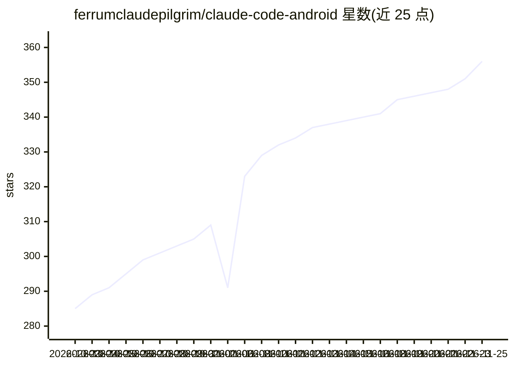

# ferrumclaudepilgrim/claude-code-android

⭐ 356 · Shell · MIT · 推送 2026-10-26 · [GitHub](https://github.com/ferrumclaudepilgrim/claude-code-android) · [官网](https://ferrumclaudepilgrim.com) · 个人维护

**在 Android 手机上经 Termux/AVF 本地运行 Claude Code 的安装器**

为一部 64 位 Android 手机（8+，无 root）提供三条运行 Claude Code CLI 的路径：A) Termux 兼容层直接运行官方 Linux 版，附带每日更新检查、崩溃回退与 DNS 解析器默认调整；B) proot-distro 内 Ubuntu（约 2 GB，用 Anthropic 官方安装器）；C) AVF Debian 虚拟机（实验性，需系统提供 Linux 开发环境选项）。含脚本安装、设备兼容性实测清单与 agent 安全指引。维护者声明独自维护、非安全专业人员。

## 筛选速览

| 维度 | 判定 | 备注 |
|---|---|---|
| AI 角色 | `ai-ecosystem` | LLM/agent 周边工具 |
| 许可风险 | `permissive` | MIT |
| 部署形态 | `None` |  |
| 模型依赖 | locked-api |  |
| 硬件要求 | — | 无带数字的原话,不猜 |
| 安装摩擦 | `low` | 无编译、无系统依赖或容器化 |
| 成熟度 | — | 结构信号不足 |

## 能力要点

- 一键安装脚本（curl+bash install.sh）在 Termux 内完成部署
- 三条路径：Termux 原生、proot Ubuntu、AVF Debian 虚拟机
- 启动器含每日更新检查、崩溃检测与旧版本回退
- 针对手机场景的 prompt injection 与权限安全指引

## 适用场景

- 没有电脑时在手机上运行 Claude Code 编程
- 通过 Termux:API/ADB 让 agent 操作手机功能（语音、通知、定位）
- 在设备上直接编译 C/C++ 代码并运行多 agent 工作流

## 场景标签

`编码 Agent` · 领域:编码与开发

## 证据(README 行号)

> L44: "Native" means it runs on your phone, not on a remote machine. Anthropic doesn't publish an Android version, so Pat
> L70: This project helps you run the Claude Code CLI on an Android device. At its base it is very close to the standard e
> L173: > This is an independent community project. It is not affiliated with or endorsed by Anthropic, Google, or OpenAI.

## 星数曲线

2026-10-23 285 → 2026-11-25 356（+71）

---
*卡片 v1 · prompt 1.4 · 生成 2026-11-25 · 置信度 high · 依据 README sha `c7da80c01ff5` · [字段定义](../../DATASET.md)*
