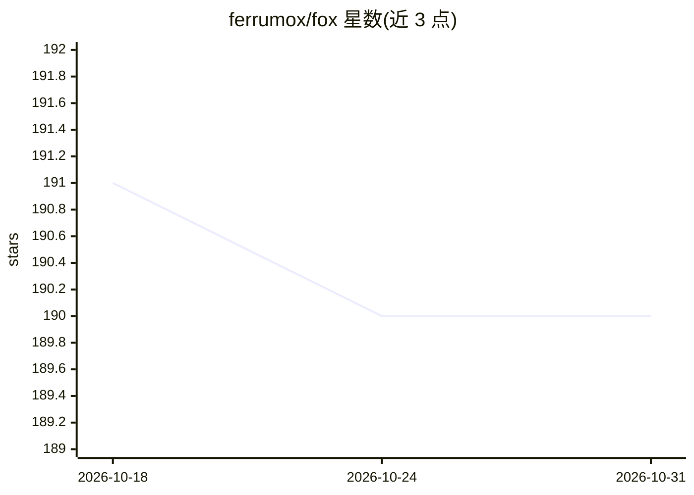

# ferrumox/fox

⭐ 190 · Rust · NOASSERTION · 推送 2026-08-22 · [GitHub](https://github.com/ferrumox/fox) · [官网](https://ferrumox.com) · 组织维护

**面向并发场景的本地 LLM 服务器，Ollama 的替换品**

用 Rust 编写、封装 llama.cpp 的本地推理服务器，在同一端口同时提供 OpenAI 兼容的 /v1/* 与 Ollama 兼容的 /api/* 接口。核心机制是跨请求的 KV cache 共享：序列保留已驻留 token，新请求匹配最长共享前缀跳过 prefill，并发的同前缀请求可从正在解码的序列复制前缀、共享 block 预算；配合连续批处理与投机解码。支持任意 GGUF 模型、多模型懒加载与 LRU 逐出、结构化输出、LoRA、多 GPU 切分、KV 量化与 Prometheus 指标。限制：预编译二进制仅 Linux x86_64，macOS/Windows 需自行编译或在 WSL2 下运行。

## 筛选速览

| 维度 | 判定 | 备注 |
|---|---|---|
| AI 角色 | `ai-ecosystem` | LLM/agent 周边工具 |
| 许可风险 | `permissive` | NOASSERTION |
| 部署形态 | `self-host` | docker 或自建部署 |
| 模型依赖 | local-ok | 支持本地模型 |
| 硬件要求 | — | 无带数字的原话,不猜 |
| 安装摩擦 | `low` | 无编译、无系统依赖或容器化 |
| 成熟度 | — | 结构信号不足 |

## 能力要点

- 同一端口提供 OpenAI 与 Ollama 两套兼容 API，现有客户端仅需改 base URL
- 跨请求共享前缀的 KV cache 复用：并发同前缀请求只付一次 prefill
- 单二进制运行时检测 CUDA/ROCm/Vulkan/Metal 后端，无需按厂商重编译
- 多模型懒加载、LoRA 运行时调参、KV 量化与 MoE 专家卸载到内存

## 适用场景

- 把基于 Ollama 或 OpenAI SDK 的现有工具无改动地切到本地推理服务
- 高并发同系统提示词的服务场景（如多客户端共享前缀的批处理）
- 单机多 GPU / 内存受限环境下的本地多模型部署与监控

## 场景标签

`推理引擎` · 领域:训练与推理

## 证据(README 行号)

> L3: **A local LLM server built for concurrent work. Drop-in replacement for Ollama.**
> L36: Fox wraps llama.cpp, so a single request decoding on its own runs the same kernels
> L263: **Two APIs, no code changes.** OpenAI-compatible `/v1/*` and Ollama-compatible `/api/*`

## 星数曲线

2026-10-18 191 → 2026-10-31 190（-1）

---
*卡片 v1 · prompt 1.4 · 生成 2026-10-22 · 置信度 high · 依据 README sha `75e9244b84fc` · [字段定义](../../DATASET.md)*
