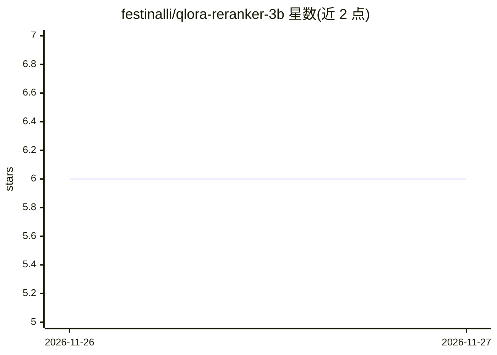

# festinalli/qlora-reranker-3b

⭐ 6 · Python · MIT · 推送 2026-11-19 · [GitHub](https://github.com/festinalli/qlora-reranker-3b) · 个人维护

**用 QLoRA 在 8GB 笔记本 GPU 上微调 3B 搜索重排序模型**

一个实验性仓库：训练小模型替代企业系统中的 LLM API 重排序调用——对用户问题与 40 个候选屏幕卡片逐个判「Sim/Não」，以首 token P(Sim) 排序。仓库不含客户数据与 adapter 权重，只提供代码、QLoRA 配置、盲测协议（sha256 冻结、单次测量）、盈亏平衡计算与端到端合成数据示例（8GB GPU 约 9 分钟跑完）。基于 Unsloth+TRL SFTTrainer，基座为 4bit Qwen2.5-Coder-3B。需 NVIDIA GPU 与 CUDA，仅在 WSL2/Ubuntu 测试。

## 筛选速览

| 维度 | 判定 | 备注 |
|---|---|---|
| AI 角色 | `ai-native` | 本体是模型或模型工具 |
| 许可风险 | `permissive` | MIT |
| 部署形态 | `library` | 以包/库形式分发 |
| 模型依赖 | — | README 未给出锁定关系 |
| 硬件要求 | — | 无带数字的原话,不猜 |
| 安装摩擦 | `medium` | 含编译或系统依赖之一 |
| 成熟度 | — | 结构信号不足 |

## 能力要点

- 两轮盲测：168/142 题，与 gpt-4.1-mini 1-step 结果作 McNemar 检验
- 8GB 笔记本 GPU（RTX 5070）可训练，峰值 VRAM 约 5.85GB
- 盲测冻结协议：sha256 记录、只读、单次测量、拒绝重复测试
- 盈亏平衡计算脚本，API 价格作为参数

## 适用场景

- 在自己数据上复现这条 QLoRA 重排序微调流程
- 评估本地小模型替代 API 重排序调用的成本平衡点
- 参考其盲测协议设计自己的模型对比实验

## 场景标签

`微调` · 领域:训练与推理

## 证据(README 行号)

> L1: # Reranker local com QLoRA: um modelo de 3B numa GPU de 8 GB
> L34: |Modelo base|`unsloth/Qwen2.5-Coder-3B-Instruct-bnb-4bit` (3B, em 4 bits)|
> L61: - Contra o gpt-4.1-mini **de 1 passo**, o resultado é um **empate estatístico**: 111 contra 107, p = 0,65. Ou seja,

## 星数曲线

2026-11-26 6 → 2026-11-27 6（+0）

---
*卡片 v1 · prompt 1.4 · 生成 2026-11-26 · 置信度 high · 依据 README sha `679a448cd2d2` · [字段定义](../../DATASET.md)*
