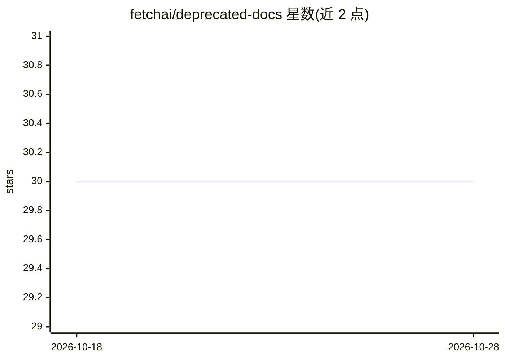

# fetchai/deprecated-docs

⭐ 30 · TypeScript · Apache-2.0 · 推送 2026-07-07 · [GitHub](https://github.com/fetchai/deprecated-docs) · [官网](https://www.fetch.ai/docs) · 组织维护

**Fetch.ai 官方文档站点的代码仓库（AI Agent、AI Engine、Fetch Network 等）**

托管 Fetch.ai 官方文档站点 fetch.ai/docs 的代码仓库，内容覆盖 AI Agents、AI Engine、Fetch Network 等主题。README 仅给出站点开发流程：用 pnpm 安装依赖、运行开发服务器（地址 http://127.0.0.1:3000/docs），并说明贡献方式、行为准则与通过 GitHub Issues/Discussions 提问的渠道。仓库名称含 deprecated 标记，指示此文档仓库已弃用。

## 筛选速览

| 维度 | 判定 | 备注 |
|---|---|---|
| AI 角色 | `ai-knowledge` | 知识聚合/清单类 |
| 许可风险 | `permissive` | Apache-2.0 |
| 部署形态 | `library` | 以包/库形式分发 |
| 模型依赖 | — | README 未给出锁定关系 |
| 硬件要求 | — | 无带数字的原话,不猜 |
| 安装摩擦 | `low` | 无编译、无系统依赖或容器化 |
| 成熟度 | — | 结构信号不足 |

## 能力要点

- fetch.ai/docs 官方文档站点的源码仓库
- 覆盖 AI Agents、AI Engine、Fetch Network 等文档主题
- 提供 pnpm 安装依赖与开发服务器运行流程

## 适用场景

- 查阅 Fetch.ai AI Agent 与 Fetch Network 的官方文档
- 为文档站点贡献内容或提交勘误
- 本地运行文档站点预览改动

## 场景标签

 · 领域:区块链/AI Agent 文档

## 证据(README 行号)

> L1: # Fetch.ai Documentation Repo
> L5: Welcome to the code repository for Fetch.ai's documentation at fetch.ai/docs.

## 星数曲线

2026-10-18 30 → 2026-10-28 30（+0）

---
*卡片 v1 · prompt 1.4 · 生成 2026-10-26 · 置信度 low · 依据 README sha `e481950239f9` · [字段定义](../../DATASET.md)*
