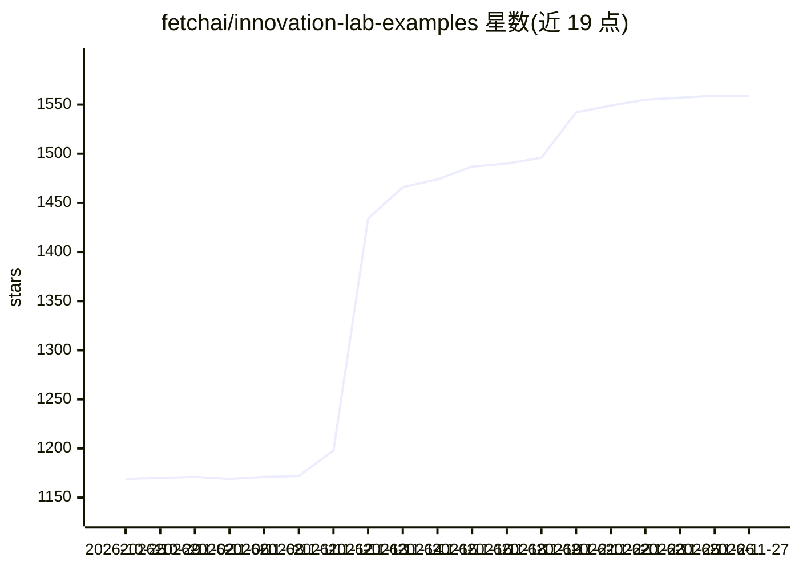

# fetchai/innovation-lab-examples

⭐ 1,559 · Python · MIT · 推送 2026-11-23 · [GitHub](https://github.com/fetchai/innovation-lab-examples) · [官网](https://innovationlab.fetch.ai/resources/docs/intro) · 组织维护

**为 Python 开发者提供 80+ 可直接运行的 AI agent 示例项目**

Fetch.ai Innovation Lab 维护的示例仓库，每个文件夹是自包含可运行的 AI agent 项目，含 README、依赖清单与环境变量模板。示例按入门、LLM 集成、A2A 协议、MCP、支付、RAG、多智能体、Web3 与外部集成等类别组织，基于 uAgents 框架，覆盖 Agentverse 部署、ASI:One 调用与支付集成。多数示例需要至少一个 API key；提供 setup.sh 脚本与 Docker 方式运行，Apache 2.0 许可。

## 筛选速览

| 维度 | 判定 | 备注 |
|---|---|---|
| AI 角色 | `ai-knowledge` | 知识聚合/清单类 |
| 许可风险 | `permissive` | MIT |
| 部署形态 | `self-host` | docker 或自建部署 |
| 模型依赖 | locked-api |  |
| 硬件要求 | — | 无带数字的原话,不猜 |
| 安装摩擦 | `low` | 无编译、无系统依赖或容器化 |
| 成熟度 | — | 结构信号不足 |

## 能力要点

- 80+ 自包含可运行的 agent 示例，按 9 个类别组织（入门/LLM/A2A/MCP/支付/RAG/多智能体/Web3/集成）
- 覆盖 ASI:One、Claude、Gemini、OpenAI、LangChain、CrewAI 等多种框架与模型接入
- git clone 后运行 setup.sh 或用 Docker/Compose 运行任意示例
- 贡献者示例收录在 contributors/ 目录，附 PR 与 lint/测试流程

## 适用场景

- 初次接触自治 agent 时找可运行起点
- 为集成 LLM、支付或 Web3 到 agent 工作流取模板
- 黑客松需要几分钟内跑通的 starter 项目
- 学习 A2A 与框架编排两种多智能体模式

## 场景标签

`Agent 框架` `多智能体` `RAG` `教程课程` · 领域:Agent 开发

## 证据(README 行号)

> L3: ### 80+ production-ready AI agent examples in Python
> L30: Every folder here is a **self-contained, runnable AI agent project** with its own README, dependencies and
> L31: environment template. Whether you are writing your first autonomous agent or architecting a multi-agent

## 星数曲线

2026-10-25 1,169 → 2026-11-27 1,559（+390）

---
*卡片 v1 · prompt 1.4 · 生成 2026-11-23 · 置信度 high · 依据 README sha `a5eecc8bf635` · [字段定义](../../DATASET.md)*
