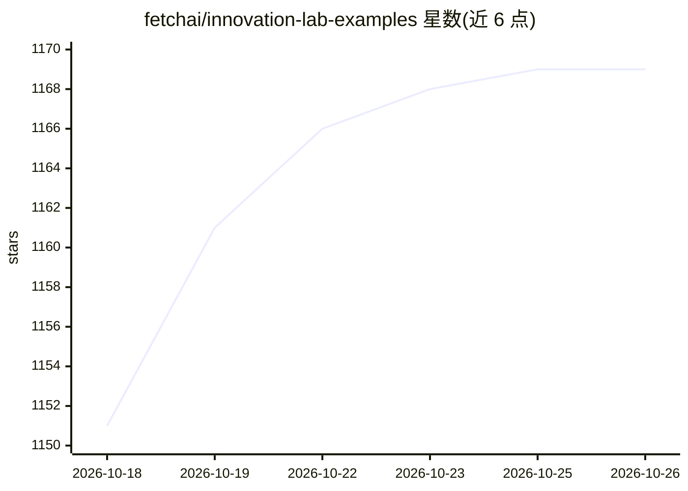

# fetchai/innovation-lab-examples

⭐ 1,169 · Python · MIT · 推送 2026-09-01 · [GitHub](https://github.com/fetchai/innovation-lab-examples) · [官网](https://innovationlab.fetch.ai/resources/docs/intro) · 组织维护

**80+ 可运行的 AI agent 示例合集：基于 uAgents 构建自主与多智能体**

Fetch.ai Innovation Lab 维护的 Python AI agent 示例仓库：每个目录是自带 README、依赖与 .env 模板的独立可运行工程，覆盖入门模板、LLM 集成（ASI:One/Gemini/Claude/OpenAI）、A2A 协议、MCP、支付（FET/Stripe/Skyfire）、RAG、多智能体编排（CrewAI/AG2/Google ADK）、Web3 与浏览器自动化等类别。agent 使用 LLM 做推理，uAgents 框架负责消息、发现与支付。提供 git clone 快速开始、setup.sh 自动化脚本与 Docker/Docker Compose 运行方式，Apache 2.0 许可，多数示例需至少一个 API key。

## 筛选速览

| 维度 | 判定 | 备注 |
|---|---|---|
| AI 角色 | `ai-knowledge` | 知识聚合/清单类 |
| 许可风险 | `permissive` | MIT |
| 部署形态 | `self-host` | docker 或自建部署 |
| 模型依赖 | — | README 未给出锁定关系 |
| 硬件要求 | — | 无带数字的原话,不猜 |
| 安装摩擦 | `low` | 无编译、无系统依赖或容器化 |
| 成熟度 | — | 结构信号不足 |

## 能力要点

- 每个目录为自包含可运行工程，含独立 README/依赖/.env 模板
- 覆盖 A2A、MCP、支付、RAG、多智能体编排等 10+ 类场景
- 提供 Docker 与 Docker Compose 容器化运行方式
- 按 Beginner/Intermediate/Advanced 标注示例难度

## 适用场景

- 初学者按难度找可运行的 agent 起手工程
- 黑客松参与者在几分钟内获得工作模板
- 开发者学习 A2A/MCP/支付等多智能体集成模式

## 场景标签

`Agent 框架` `多智能体` `教程课程` · 领域:Agent 开发

## 证据(README 行号)

> L30: Every folder here is a **self-contained, runnable AI agent project** with its own README, dependencies and
> L3: ### 80+ production-ready AI agent examples in Python

## 星数曲线

2026-10-18 1,151 → 2026-10-26 1,169（+18）

---
*卡片 v1 · prompt 1.4 · 生成 2026-10-21 · 置信度 high · 依据 README sha `f5ea331af8bb` · [字段定义](../../DATASET.md)*
