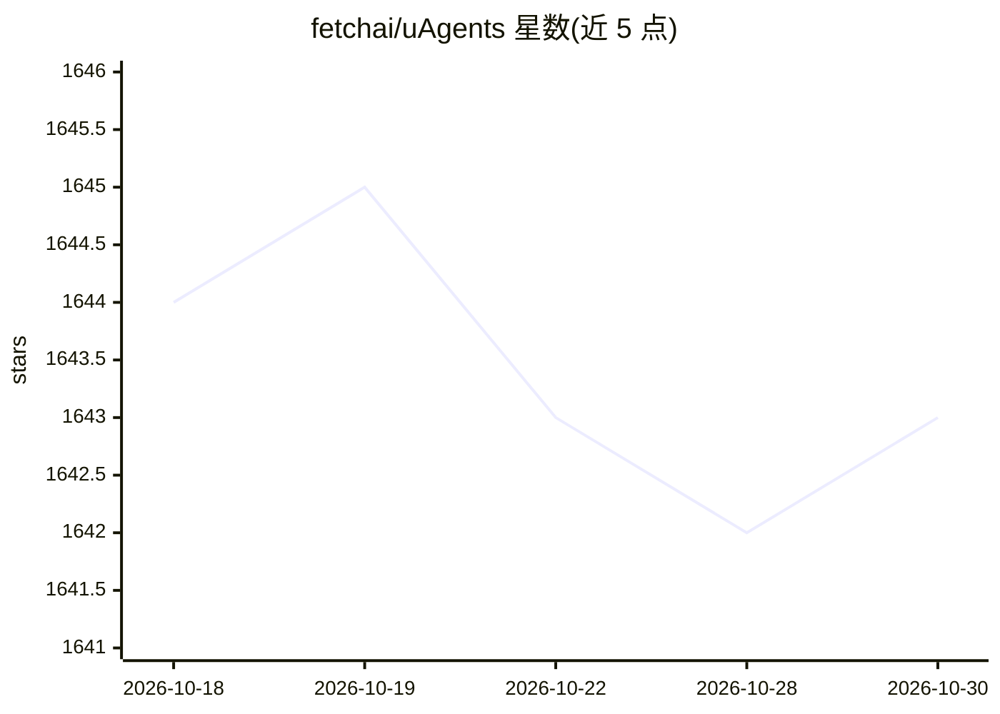

# fetchai/uAgents

⭐ 1,643 · Python · Apache-2.0 · 推送 2026-10-26 · [GitHub](https://github.com/fetchai/uAgents) · 组织维护

**给开发者：用 Python 创建去中心化自主 AI agent 的框架**

Fetch.ai 开发的 Python 库，通过装饰器（如 on_interval、事件处理）定义 agent 的定时任务与事件响应行为。agent 启动时自动注册到部署在 Fetch.ai 区块链上的 Almanac 智能合约，加入 uAgents 网络；消息与钱包采用密码学保护，可向 Agentverse 控制台上报遥测事件。提供 pip 安装（Python 3.10–3.13），另有 uagents-core 核心库与示例仓库。许可为 Apache 2.0，按 'as-is' 免责提供。

## 筛选速览

| 维度 | 判定 | 备注 |
|---|---|---|
| AI 角色 | `ai-ecosystem` | LLM/agent 周边工具 |
| 许可风险 | `permissive` | Apache-2.0 |
| 部署形态 | `library` | 以包/库形式分发 |
| 模型依赖 | — | README 未给出锁定关系 |
| 硬件要求 | — | 无带数字的原话,不猜 |
| 安装摩擦 | `low` | 无编译、无系统依赖或容器化 |
| 成熟度 | — | 结构信号不足 |

## 能力要点

- 装饰器方式定义 agent 的定时任务与事件响应
- agent 自动注册到 Fetch.ai 区块链上的 Almanac 智能合约
- 消息与钱包的密码学安全保护
- 可向 Agentverse 上报启停、消息与错误遥测事件

## 适用场景

- 我想用 Python 快速构建可定时或按事件执行任务的自主 agent
- 我需要让多个 agent 在去中心化网络中互相发现与通信
- 我想接入 Fetch.ai 生态与 agent marketplace 构建应用

## 场景标签

`Agent 框架` `多智能体` · 领域:Agent 开发

## 证据(README 行号)

> L6: uAgents is a library developed by Fetch.ai that allows for creating autonomous AI agents in Python. With simple and 
> L11: - 🔗 **Connected**: On startup, each agent automatically joins the fast-growing network of uAgents by registering on

## 星数曲线

2026-10-18 1,644 → 2026-10-30 1,643（-1）

---
*卡片 v1 · prompt 1.4 · 生成 2026-10-21 · 置信度 high · 依据 README sha `f231bb1399de` · [字段定义](../../DATASET.md)*
