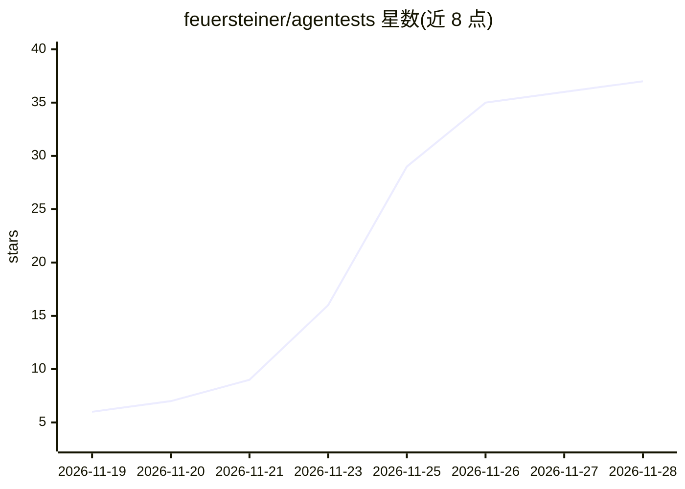

# feuersteiner/agentests

⭐ 37 · TypeScript · MIT · 推送 2026-11-25 · [GitHub](https://github.com/feuersteiner/agentests) · [官网](https://discord.gg/kESK4bgEPW) · 个人维护

**让团队把业务规则转成可验证测试的 Agent 工具**

agentests 是一个 npm CLI 与库：用自然语言写下业务规则或代码约定，由编码 agent 将其编译为窄化的 yes/no 检查项（test.yaml）与配套 eval 用例，pre-commit 钩子在每次提交时运行检查并指出违规文件。文本检查与退出码为确定性执行；决策与推理模型通过配置文件按 api/url/model/apiKeyEnv 指定，需相应 API key；规则与 eval 以普通文件形式存于仓库中。

## 筛选速览

| 维度 | 判定 | 备注 |
|---|---|---|
| AI 角色 | `ai-ecosystem` | LLM/agent 周边工具 |
| 许可风险 | `permissive` | MIT |
| 部署形态 | `library` | 以包/库形式分发 |
| 模型依赖 | — | README 未给出锁定关系 |
| 硬件要求 | — | 无带数字的原话,不猜 |
| 安装摩擦 | `low` | 无编译、无系统依赖或容器化 |
| 成熟度 | — | 结构信号不足 |

## 能力要点

- 自然语言规则编译为 yes/no 检查与本地文本检查，输出确定性
- 配套 eval 机制：编译后的 Test 自带用例，可验证检查是否成立
- pre-commit 钩子检查 staged 文件并在违规时阻断提交
- 以 npm 包同时提供 CLI 与 TypeScript 库

## 适用场景

- 把品牌语气等业务决策落到每次提交的自动检查
- 为编码 agent 的工作产出建立可验证的规范测试
- 在 CI/pre-commit 流程中拦截违反规则的文件提交

## 场景标签

`代码审查` · 领域:编码与开发

## 证据(README 行号)

> L12: agentests shows where a decision has not reached the work. Write it once, in plain language. Your
> L60: Ask your coding agent to run `npx agentests compile brand-voice` and follow the prompt. `compile`
> L127: - `init`: writes the config, `.agents/tests/` and the hook, never overwriting. Pick providers with

## 星数曲线

2026-11-19 6 → 2026-11-28 37（+31）

---
*卡片 v1 · prompt 1.4 · 生成 2026-11-20 · 置信度 high · 依据 README sha `d32ffb1179ba` · [字段定义](../../DATASET.md)*
