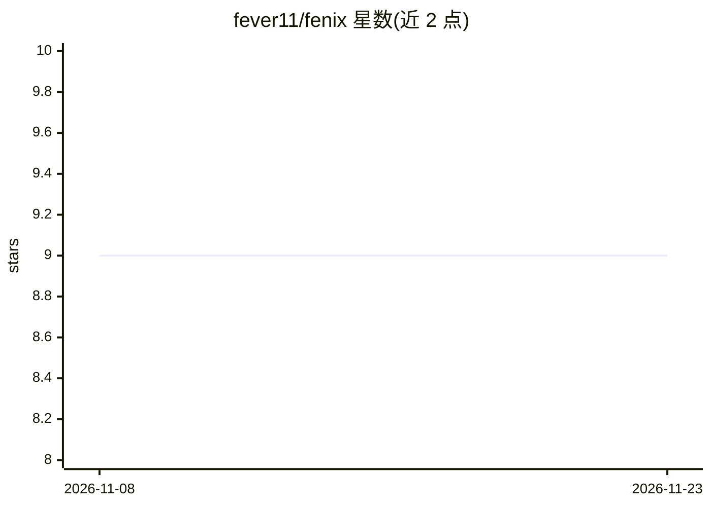

# fever11/fenix

⭐ 9 · Python · GPL-3.0 · 推送 2026-11-15 · [GitHub](https://github.com/fever11/fenix) · 个人维护

**面向 Windows 用户的土耳其语优先语音多语言桌面助手**

FENIX 是运行在 Windows 10/11 上的个人桌面助手，支持文本与按键语音对话，提供屏幕视觉识别、PDF/Word/Excel 等附件阅读、多步联网研究报告（可导出 PDF/Word）、带确认框的系统操作（打开应用/调整音量等）、提醒与持久记忆、可撤销的操作日志及系统监控面板。接入 Gemini 与 Groq 密钥，配额用尽后可切换 Cloudflare、OpenRouter、Cohere 等备用服务商；无服务器、无遥测，数据保留在本地。通过 Setup.bat 脚本安装，可自动安装 Python。

## 筛选速览

| 维度 | 判定 | 备注 |
|---|---|---|
| AI 角色 | `ai-native` | 本体是模型或模型工具 |
| 许可风险 | `viral` | GPL-3.0 |
| 部署形态 | `None` |  |
| 模型依赖 | locked-api |  |
| 硬件要求 | — | 无带数字的原话,不猜 |
| 安装摩擦 | `low` | 无编译、无系统依赖或容器化 |
| 成熟度 | — | 结构信号不足 |

## 能力要点

- 文本与按住说话（F9）语音对话，支持 6 种语言的界面、语音回复与语音识别
- 屏幕视觉问答与多步联网研究（Devil 模式），报告可导出 PDF/Word
- 可撤销操作日志：创建/覆盖/删除的文件均可恢复（自回收站保留 30 天）
- Watch 模式监控风险下载、可疑链接与剪贴板钱包地址替换

## 适用场景

- 用语音或文字让助手代为执行打开应用、调音量等日常电脑操作
- 上传 PDF/Word/Excel 文件进行提问或生成带来源的学习笔记
- 让助手执行多步网络调研并输出可导出的研究报告
- 监控下载、可疑链接与启动项变更以获得风险提示

## 场景标签

`AI 助手` · 领域:对话与助手

## 证据(README 行号)

> L4:  Sesli, çok dilli kişisel masaüstü asistanı · Voice-enabled, multilingual desktop assistant
> L22: computer — always asking for approval before anything risky.
> L27: - 💬 Text and push-to-talk voice chat (F9), with spoken replies

## 星数曲线

2026-11-08 9 → 2026-11-23 9（+0）

---
*卡片 v1 · prompt 1.4 · 生成 2026-11-20 · 置信度 high · 依据 README sha `4d0a486f7f5f` · [字段定义](../../DATASET.md)*
