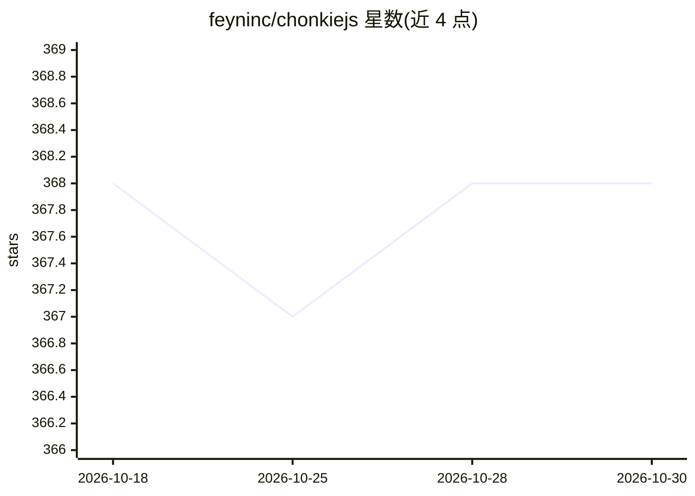

# feyninc/chonkiejs

⭐ 368 · TypeScript · MIT · 推送 2026-10-03 · [GitHub](https://github.com/feyninc/chonkiejs) · [官网](https://chonkie.ai) · 组织维护

**TypeScript 文本分块库：为 RAG 应用提供轻量分块能力**

Python 库 chonkie 的 TypeScript 移植（非 binding），面向开发 TypeScript Web 应用并需要 RAG 文本分块的开发者。@chonkiejs/core 提供 Token、Recursive、Sentence、Semantic、Code（tree-sitter AST）、Table、Fast（WASM 字节级）七种分块器，零依赖、基于字符计数分词；另有接入 api.chonkie.ai 的 cloud 包和支持 HuggingFace tokenizer 的 token 包。README 声明仍在活跃开发中，尚未与原库功能对齐。

## 筛选速览

| 维度 | 判定 | 备注 |
|---|---|---|
| AI 角色 | `ai-ecosystem` | LLM/agent 周边工具 |
| 许可风险 | `permissive` | MIT |
| 部署形态 | `library` | 以包/库形式分发 |
| 模型依赖 | — | README 未给出锁定关系 |
| 硬件要求 | — | 无带数字的原话,不猜 |
| 安装摩擦 | `low` | 无编译、无系统依赖或容器化 |
| 成熟度 | `idea` | |

## 能力要点

- 七种本地分块器：Token/Recursive/Sentence/Semantic/Code/Table/Fast
- @chonkiejs/core 零依赖，统一 await ChunkerClass.create + chunk(text) 接口
- FastChunker 基于 WASM 的高吞吐字节级分块
- 可选 cloud 包（api.chonkie.ai）与 HuggingFace tokenizer 支持

## 适用场景

- 在 TypeScript RAG 应用中做文档预处理分块
- 按语义边界或句子边界切分文本供检索使用
- 对源代码或 Markdown 表格做结构感知分块

## 场景标签

 · 领域:NLP/RAG 工具库

## 证据(README 行号)

> L12: _🦛 CHONK your texts in TypeScript with Chonkie!✨ The no-nonsense lightweight and efficient chunking library._
> L20: We built `chonkiejs` while developing a TypeScript web app that needed fast, on-the-fly text chunking for RAG appli
> L53: |@chonkiejs/core|Local chunking (Recursive, Token, Sentence, Semantic, Code, Table, Fast) with character-based toke

## 星数曲线

2026-10-18 368 → 2026-10-30 368（+0）

---
*卡片 v1 · prompt 1.4 · 生成 2026-10-21 · 置信度 high · 依据 README sha `6161ec3b9938` · [字段定义](../../DATASET.md)*
