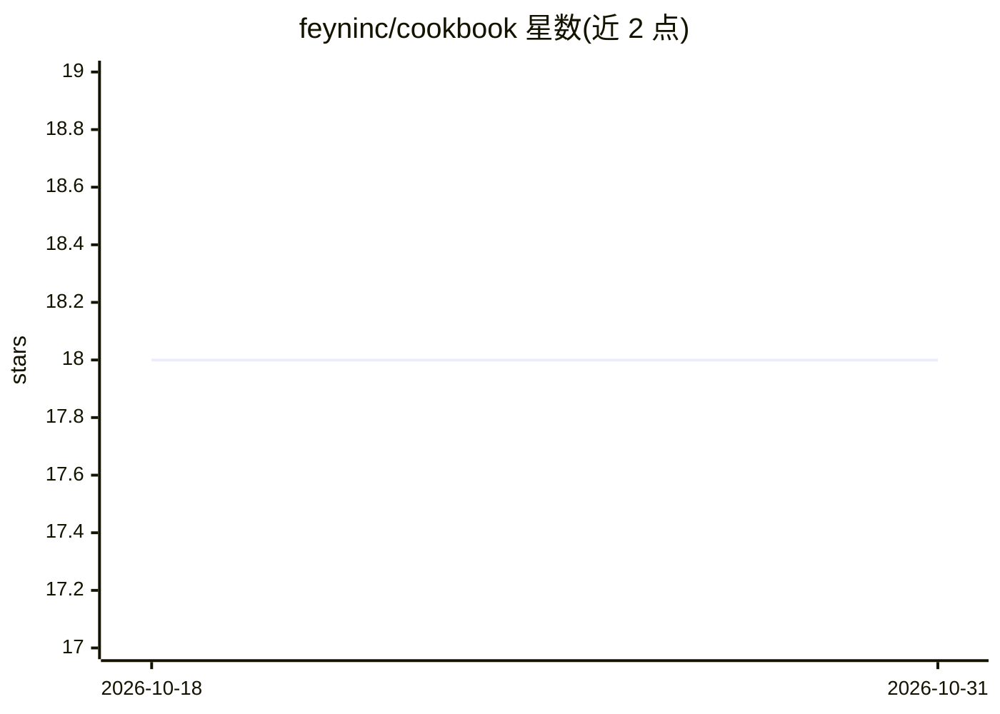

# feyninc/cookbook

⭐ 18 · Jupyter Notebook · MIT · 推送 2026-02-28 · [GitHub](https://github.com/feyninc/cookbook) · [官网](https://docs.chonkie.ai) · 组织维护

**Chonkie 文本分块库的示例、教程与社区资源集合**

Chonkie 官方 cookbook 仓库，汇集使用 Chonkie 的示例、教程与项目：覆盖递归分块构建 RAG 流水线、OpenRouter 模型驱动的 SlumberChunker、JSON 导出、Gemini 嵌入、Pgvector/Pinecone/Qdrant 向量库对接以及 LlamaIndex 节点解析等教程，多数提供 Colab 笔记本或 GitHub 源码入口。另收录社区集成项目（FlashRAG、Txtai、SurfSense 等）与社区博客、视频和项目资源，通过 issue 提交贡献。面向使用 Chonkie 构建 RAG/分块流水线的开发者。

## 筛选速览

| 维度 | 判定 | 备注 |
|---|---|---|
| AI 角色 | `ai-knowledge` | 知识聚合/清单类 |
| 许可风险 | `permissive` | MIT |
| 部署形态 | `None` |  |
| 模型依赖 | — | README 未给出锁定关系 |
| 硬件要求 | — | 无带数字的原话,不猜 |
| 安装摩擦 | `low` | 无编译、无系统依赖或容器化 |
| 成熟度 | — | 结构信号不足 |

## 能力要点

- 官方教程覆盖递归分块、SlumberChunker、JSON 导出与多种向量库对接
- 教程多提供 Open In Colab 可运行入口
- 收录社区集成项目与博客/视频/项目资源清单
- 通过 issue 提交贡献的开放机制

## 适用场景

- 学习如何用 Chonkie 做文档分块并搭建 RAG 流水线
- 查找 Chonkie 与向量数据库或 LlamaIndex 的集成示例
- 发现基于 Chonkie 的社区工具与生态项目

## 场景标签

`RAG` `教程课程` `精选清单` · 领域:知识与检索

## 证据(README 行号)

> L4: _A collection of examples, tutorials, and projects using Chonkie_
> L6: ## 📖 Official Tutorials

## 星数曲线

2026-10-18 18 → 2026-10-31 18（+0）

---
*卡片 v1 · prompt 1.4 · 生成 2026-10-29 · 置信度 high · 依据 README sha `10343bfd5c1b` · [字段定义](../../DATASET.md)*
