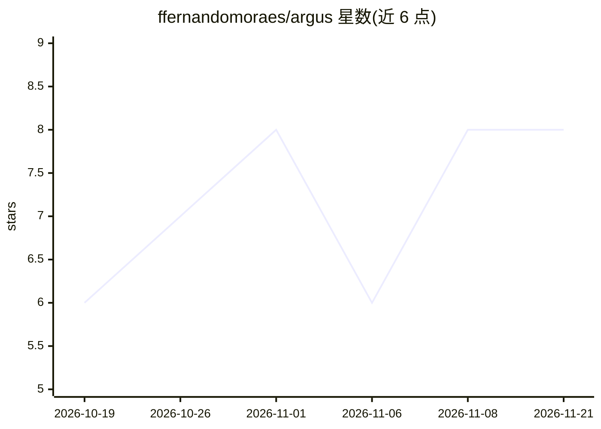

# ffernandomoraes/argus

⭐ 8 · TypeScript · NOASSERTION · 推送 2026-11-19 · [GitHub](https://github.com/ffernandomoraes/argus) · 个人维护

**无限画布桌面应用：集中跟踪多个项目与代码 Agent 会话**

基于 Electron 的桌面应用，把多个项目以卡片形式放在同一画布上，并行运行多路 Claude Code、Codex、Gemini CLI、Cursor CLI 会话与终端，展示每个会话的当前状态、耗时，并在会话结束、请求权限或提问时发通知。支持按客户/场景分组的彩色项目组、每组绑定不同的 Claude 账户及用量显示、画布便签、跨平台远程访问（QR 码配对、端到端加密桥接）。本地运行，不要求 Argus 账户或 API key，使用机器上已有的 Claude Code 与订阅。

## 筛选速览

| 维度 | 判定 | 备注 |
|---|---|---|
| AI 角色 | `ai-ecosystem` | LLM/agent 周边工具 |
| 许可风险 | `none` | NOASSERTION |
| 部署形态 | `desktop` | 安装包/桌面程序 |
| 模型依赖 | — | README 未给出锁定关系 |
| 硬件要求 | — | 无带数字的原话,不猜 |
| 安装摩擦 | `low` | 无编译、无系统依赖或容器化 |
| 成熟度 | — | 结构信号不足 |

## 能力要点

- 多项目画布：并行会话、终端、便签、分组与 workspace 管理
- 会话状态通知：结束、权限请求、提问时提醒
- 每组绑定一个 Claude 账户并显示用量限额
- 远程访问：另一台电脑或手机经加密连接查看与操作

## 适用场景

- 同时服务多个客户、需要分账户跟踪各项目 Agent 会话
- 让多个 Agent 任务并行跑，结束或卡权限时收到提醒
- 离开电脑后用手机继续查看和推进 Agent 会话

## 场景标签

`编码 Agent` · 领域:编码与开发

## 证据(README 行号)

> L6:  Um canvas para tocar vários projetos ao mesmo tempo com Claude Code, Codex, Gemini e Cursor, com tudo à vista.
> L48: Claude Code, Codex, Gemini CLI e Cursor CLI, cada um com uma tarefa
> L113: 2. **Entre com o Claude.** O Argus usa o Claude Code da sua máquina e a assinatura que você já

## 星数曲线

2026-10-19 6 → 2026-11-21 8（+2）

---
*卡片 v1 · prompt 1.4 · 生成 2026-11-20 · 置信度 mid · 依据 README sha `bd3091efed7c` · [字段定义](../../DATASET.md)*
