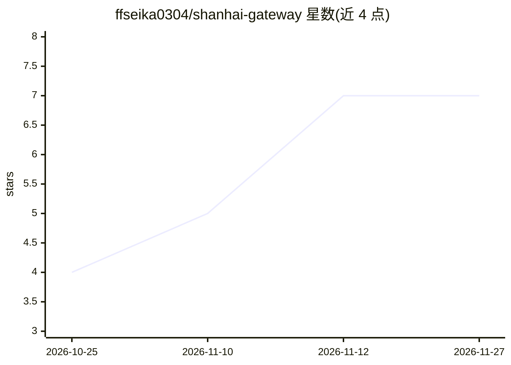

# ffseika0304/shanhai-gateway

⭐ 7 · Go · MIT · 推送 2026-11-05 · [GitHub](https://github.com/ffseika0304/shanhai-gateway) · [官网](https://seika.ltd/) · 个人维护 · 中文 README

**多上游 LLM API 网关：聚合供应商为一个 OpenAI 兼容端点**

用 Go 编写的多上游 LLM API 网关，把多个模型供应商组织成一个 OpenAI 兼容端点，提供 SWRR 加权轮转、按错误类别驱动的指数冷却与熔断、任务级会话亲和（提升前缀缓存命中）、上游怪癖适配层、多用户下游 key 计费、SQLite 影子留存观测与配置热加载。面向需要自托管网关、聚合免费/商业上游池的开发者与运维。支持 Docker 与裸跑二进制两种部署形态，sidecar 进程做慢周期限流/降级决策。

## 筛选速览

| 维度 | 判定 | 备注 |
|---|---|---|
| AI 角色 | `ai-ecosystem` | LLM/agent 周边工具 |
| 许可风险 | `permissive` | MIT |
| 部署形态 | `self-host` | docker 或自建部署 |
| 模型依赖 | — | README 未给出锁定关系 |
| 硬件要求 | — | 无带数字的原话,不猜 |
| 安装摩擦 | `low` | 无编译、无系统依赖或容器化 |
| 成熟度 | — | 结构信号不足 |

## 能力要点

- SWRR 加权轮转 + 兜底链隔离
- 任务级会话亲和（X-Job-Id / X-Session-Key）
- 错误分类学驱动的指数退避冷却与满载排队
- 上游怪癖层：内核零按名分支，按家差异写独立包

## 适用场景

- 把多个模型供应商聚合为一个 OpenAI 兼容端点
- 混编免费/赠送额度池与商业付费通道
- 为多用户下游发放带额度的 sk-user-* key
- 自托管网关并观测 attempts/captures 细粒度统计

## 场景标签

`模型网关` · 领域:Agent 开发

## 证据(README 行号)

> L5:  把多个上游模型供应商组织成一个 OpenAI 兼容端点
> L26: 山海关就是这么长出来的网关：把各路免费池、代金券和按量套餐拧成一个稳定的上游池，替你把失败截住，把账单砍下来。

## 星数曲线

2026-10-25 4 → 2026-11-27 7（+3）

---
*卡片 v1 · prompt 1.4 · 生成 2026-11-20 · 置信度 high · 依据 README sha `bc7d624e7df2` · [字段定义](../../DATASET.md)*
