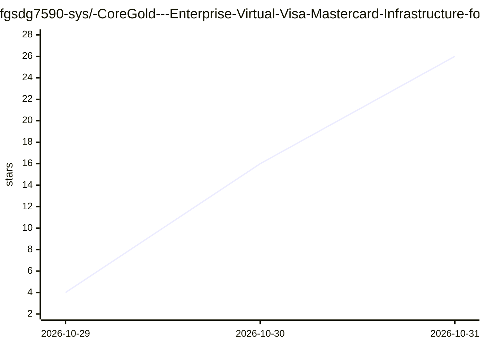

# fgsdg7590-sys/-CoreGold---Enterprise-Virtual-Visa-Mastercard-Infrastructure-for-Ad-Scaling-Cross-Border-Ops

⭐ 26 · 推送 2026-10-28 · [GitHub](https://github.com/fgsdg7590-sys/-CoreGold---Enterprise-Virtual-Visa-Mastercard-Infrastructure-for-Ad-Scaling-Cross-Border-Ops) · [官网](https://app.coregold.io/signup?invite_code=ADvlj9b) · 组织维护 · 中文 README

**面向出海团队的 Visa/Mastercard 虚拟卡发卡服务推广页**

这是一个名为 CoreGold 的虚拟卡服务的商业推广 README，非开源软件项目，未提供任何代码、安装步骤或可运行组件。声明功能包括：USDT 充值自动兑付为美金额度、批量生成独立卡号/CVV 的虚拟 Visa/Mastercard、单卡消费限额与商户绑定、销卡余额回拨。面向跨境电商与海外广告投放从业者，用途覆盖 Facebook/TikTok/Google 广告扣费、独立站采买、AI 工具订阅（OpenAI/Claude/Cursor/Midjourney）与云服务付款。全文为营销文案，含大量评价性表述，无技术细节与许可信息。

## 筛选速览

| 维度 | 判定 | 备注 |
|---|---|---|
| AI 角色 | `ai-enhanced` | 去掉 AI 部分产品仍成立 |
| 许可风险 | `none` | — |
| 部署形态 | `None` |  |
| 模型依赖 | — | README 未给出锁定关系 |
| 硬件要求 | — | 无带数字的原话,不猜 |
| 安装摩擦 | `low` | 无编译、无系统依赖或容器化 |
| 成熟度 | — | 结构信号不足 |

## 能力要点

- 声明支持 USDT 链上充值并自动结算为美金额度
- 声明可批量生成独立 16 位卡号、有效期与 CVV 的虚拟卡
- 声明单卡消费上限、商户指纹锁与余额回拨机制
- 使用方式为网页控制台操作，无本地部署内容

## 适用场景

- 海外广告平台（Facebook/TikTok/Google Ads）的开卡与验资扣费
- 独立站与多店铺的独立记账防关联
- 为 AI 工具订阅与云服务设置扣费上限

## 场景标签

 · 领域:跨境支付/虚拟卡服务

## 证据(README 行号)

> L33: |**前沿 AI 工具与高阶开发栈**|`OpenAI API 绑卡`, `Claude 3.7 / Code`, `Cursor`, `Midjourney`|完美突破发卡地区域拦截限制，稳定扣除高阶会员与按量 API 费用，不
> L48: * 进入 `卡管理` -> 点击 `生成虚拟卡`，根据实际业务选择专线卡段（如广告专线、SaaS专线）。

## 星数曲线

2026-10-29 4 → 2026-10-31 26（+22）

---
*卡片 v1 · prompt 1.4 · 生成 2026-10-30 · 置信度 low · 依据 README sha `b36425fb07b4` · [字段定义](../../DATASET.md)*
