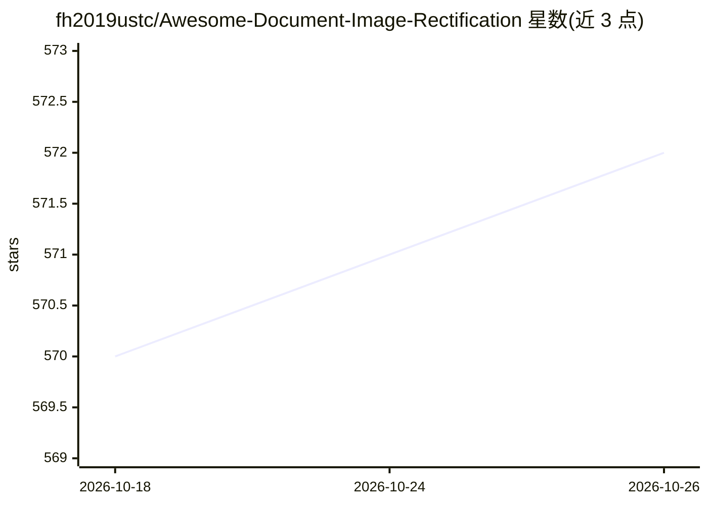

# fh2019ustc/Awesome-Document-Image-Rectification

⭐ 572 · 推送 2026-10-24 · [GitHub](https://github.com/fh2019ustc/Awesome-Document-Image-Rectification) · 个人维护

**文档图像矫正（去弯曲）论文/数据集/演示策展清单**

按年份与会议组织的文档图像矫正（dewarping/rectification）深度学习论文清单，收录 2018-2026 年约 45 篇论文，每条标注代码仓库与 DocUNet 基准结果链接；附带数据集表（区分 Real/Synthetic/Both 类型）与在线演示表（Hugging Face、textin、自托管）。面向该方向的研究者做文献与资源检索，不含可运行代码，仅为条目索引。

## 筛选速览

| 维度 | 判定 | 备注 |
|---|---|---|
| AI 角色 | `ai-knowledge` | 知识聚合/清单类 |
| 许可风险 | `none` | — |
| 部署形态 | `None` |  |
| 模型依赖 | — | README 未给出锁定关系 |
| 硬件要求 | — | 无带数字的原话,不猜 |
| 安装摩擦 | `low` | 无编译、无系统依赖或容器化 |
| 成熟度 | — | 结构信号不足 |

## 能力要点

- 2018-2026 年约 45 篇论文，含代码与结果链接
- 数据集表区分 Real/Synthetic/Both 三类
- 收录 Hugging Face / textin / 自托管在线演示条目

## 适用场景

- 查找文档矫正方向的论文与开源代码
- 对比可用的公开数据集（真实/合成）
- 寻找可直接试用的在线矫正演示

## 场景标签

`精选清单` `科研工具` · 领域:学习与行业

## 证据(README 行号)

> L2: > A comprehensive list of awesome document image rectification methods based on deep learning.
> L7: |***Year***|***Venue***|***Title***|***Repo***|***Result***|

## 星数曲线

2026-10-18 570 → 2026-10-26 572（+2）

---
*卡片 v1 · prompt 1.4 · 生成 2026-10-21 · 置信度 high · 依据 README sha `c2d94b6d2e02` · [字段定义](../../DATASET.md)*
