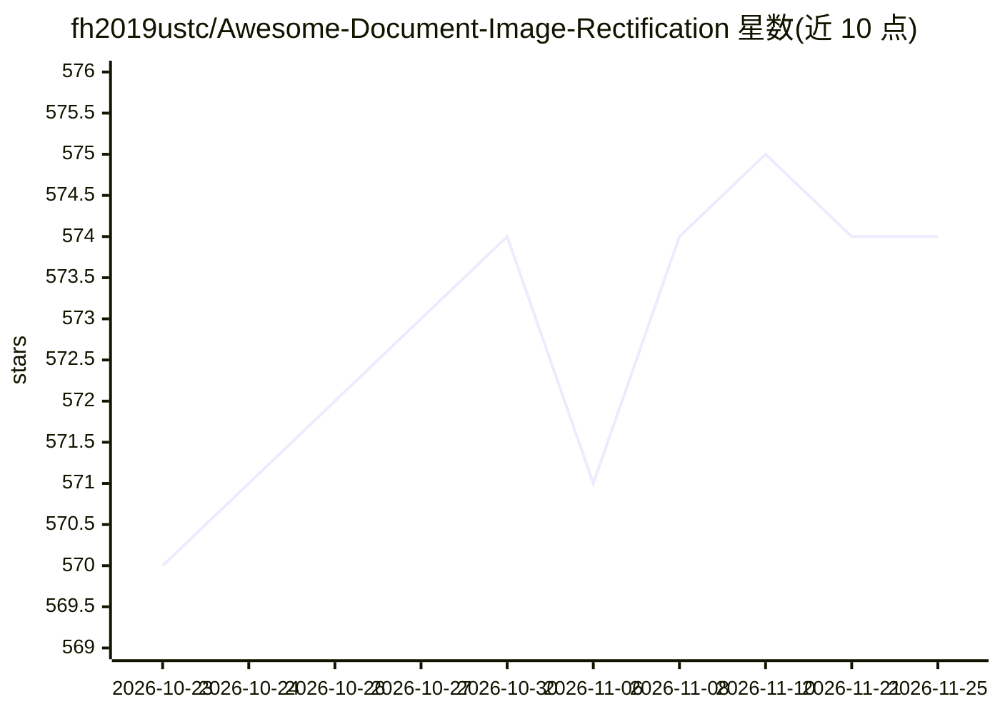

# fh2019ustc/Awesome-Document-Image-Rectification

⭐ 574 · 推送 2026-10-24 · [GitHub](https://github.com/fh2019ustc/Awesome-Document-Image-Rectification) · 个人维护

**文档图像矫正领域论文、数据集与演示的论文集清单**

按年份与发表 venue 组织的文档图像矫正（dewarping/rectification）文献清单：收录 2018–2026 年约 50 篇深度学习方法论文，部分条目附代码仓库与 DocUNet Benchmark 上的矫正结果链接；另设数据集章节区分 Real/Synthetic 类型，及在线演示章节（huggingface、self-hosted 等托管方式）。用 * 标注涉及光照校正的工作。维护者为个人，内容为静态目录，无安装或运行环节。

## 筛选速览

| 维度 | 判定 | 备注 |
|---|---|---|
| AI 角色 | `ai-knowledge` | 知识聚合/清单类 |
| 许可风险 | `none` | — |
| 部署形态 | `None` |  |
| 模型依赖 | — | README 未给出锁定关系 |
| 硬件要求 | — | 无带数字的原话,不猜 |
| 安装摩擦 | `low` | 无编译、无系统依赖或容器化 |
| 成熟度 | — | 结构信号不足 |

## 能力要点

- 收录 2018–2026 年文档图像矫正深度学习论文约 50 篇
- 条目附代码仓库与基准结果链接
- 数据集章节按 Real/Synthetic 分类
- 在线演示章节列出 huggingface/self-hosted 托管入口

## 适用场景

- 查找文档图像矫正方向的论文与开源实现
- 为方法对比寻找公开数据集
- 查找可在线试用的矫正模型演示

## 场景标签

`精选清单` · 领域:学习与行业

## 证据(README 行号)

> L2: > A comprehensive list of awesome document image rectification methods based on deep learning.
> L5: # Papers

## 星数曲线

2026-10-23 570 → 2026-11-25 574（+4）

---
*卡片 v1 · prompt 1.4 · 生成 2026-11-25 · 置信度 high · 依据 README sha `58f1b95976f8` · [字段定义](../../DATASET.md)*
