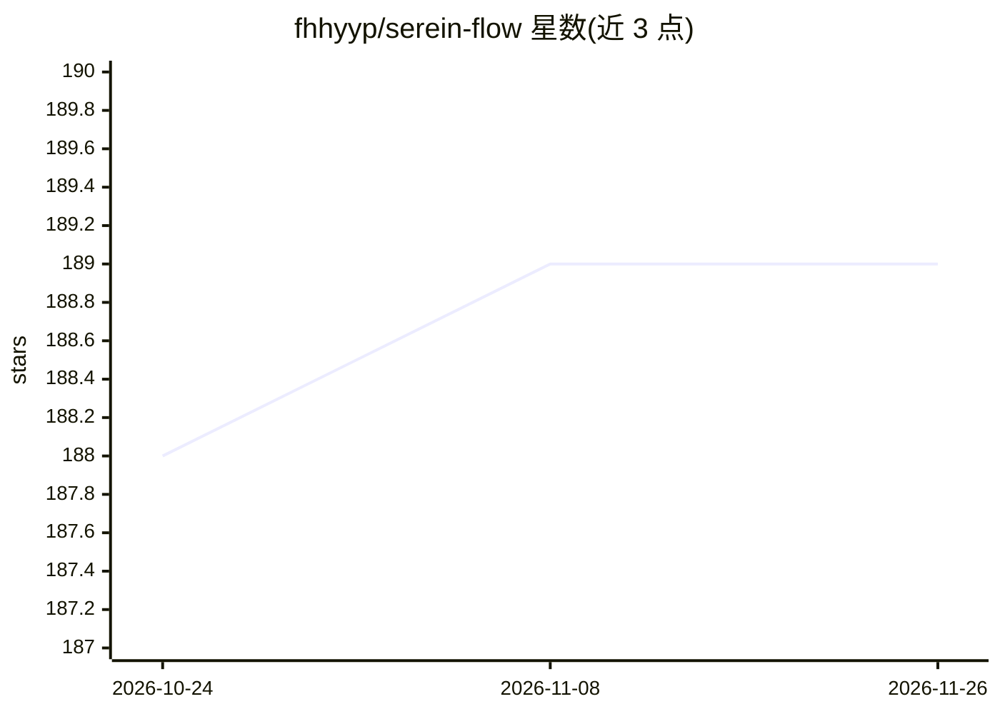

# fhhyyp/serein-flow

⭐ 189 · C# · 推送 2026-10-30 · [GitHub](https://github.com/fhhyyp/serein-flow) · 个人维护 · 中文 README

**面向开发者的节点流工作流引擎，内置 MCP 供 AI 客户端操作**

SereinFlow 是一个 web 优先的工作流编排与执行系统，由 Vue+Vite 可视化控制台、ASP.NET Core API、隔离的 Worker Runner 进程组成，用于创建、维护和运行项目工作流；API 管理 projects、flows、versions、runs 与环境设置，不受信脚本与插件仅在独立 Worker 进程中运行。内置 HTTP/stdio MCP 服务向 AI 客户端暴露 tools、resources、prompts，并配套本地 MCP 客户端与 SKILL.md 技能模板；默认无鉴权直连，可选启用 API-key 认证。

## 筛选速览

| 维度 | 判定 | 备注 |
|---|---|---|
| AI 角色 | `ai-enhanced` | 去掉 AI 部分产品仍成立 |
| 许可风险 | `none` | — |
| 部署形态 | `None` |  |
| 模型依赖 | — | README 未给出锁定关系 |
| 硬件要求 | — | 无带数字的原话,不猜 |
| 安装摩擦 | `medium` | 含编译或系统依赖之一 |
| 成熟度 | — | 结构信号不足 |

## 能力要点

- 可视化 Web 控制台管理 projects/flows/versions/runs/环境设置
- 内置 HTTP/stdio MCP 服务，暴露 tools、resources、prompts
- 不受信脚本与插件仅在隔离的 Worker Runner 进程中运行
- 提供 typed HTTP client SDK 供第三方应用集成

## 适用场景

- 搭建可维护的项目工作流并通过 Web 控制台管理运行
- 让 AI 客户端通过 MCP 安全地操作工作流系统
- 工业控制场景下做工作流编排与二次开发

## 场景标签

`工作流自动化` · 领域:效率与自动化

## 证据(README 行号)

> L7: SereinFlow is a web-first workflow orchestration and execution system. It
> L16: and plugins run only in separate Worker Runner processes. The MCP service
> L17: exposes controlled tools, resources, and prompts so AI clients can work with

## 星数曲线

2026-10-24 188 → 2026-11-26 189（+1）

---
*卡片 v1 · prompt 1.4 · 生成 2026-11-26 · 置信度 mid · 依据 README sha `825884f9b911` · [字段定义](../../DATASET.md)*
