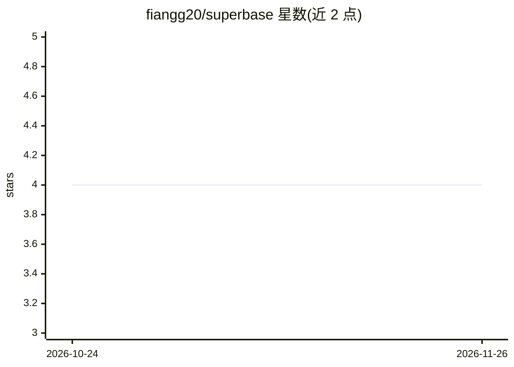

# fiangg20/superbase

⭐ 4 · JavaScript · MIT · 推送 2026-11-12 · [GitHub](https://github.com/fiangg20/superbase) · [官网](https://superbase.fiangaming005.workers.dev/) · 个人维护

**把 AI 助手接入 Roblox 执行器实时会话的本地 MCP 服务器**

Superbase 是运行在本地的 Model Context Protocol 服务器，通过 Roblox 执行器中加载的 Lua 客户端与正在运行的游戏会话通信，桥接程序缓存日志与错误并提供本地 HTTP API 与 Web 仪表盘。AI 客户端可通过 30 个工具读取控制台与脚本错误、用类 CSS 选择器遍历实例树、搜索脚本源码、监听远程调用、截图、比较快照并在游戏中执行 Lua。默认只监听 127.0.0.1；开启跨机访问需设置 host 与 token。需要 Node.js 18+ 与支持 loadstring 的执行器，截图工具仅限 Windows。

## 筛选速览

| 维度 | 判定 | 备注 |
|---|---|---|
| AI 角色 | `ai-ecosystem` | LLM/agent 周边工具 |
| 许可风险 | `permissive` | MIT |
| 部署形态 | `desktop` | 安装包/桌面程序 |
| 模型依赖 | local-ok | 支持本地模型 |
| 硬件要求 | — | 无带数字的原话,不猜 |
| 安装摩擦 | `low` | 无编译、无系统依赖或容器化 |
| 成熟度 | — | 结构信号不足 |

## 能力要点

- 30 个 MCP 工具：日志、实例树、脚本搜索、远程调用监听、GUI 操作、Lua 执行等
- 一条 npm run setup 完成依赖安装并在 AI 客户端中注册 MCP 服务器
- Web 仪表盘（127.0.0.1:9731）实时展示日志、实例浏览器与截图
- 兼容任意支持 stdio 的 MCP 客户端，支持多 Roblox 窗口并行

## 适用场景

- 让 AI 助手读取并分析 Roblox 游戏运行时的报错与日志
- 通过对话在运行中的 Roblox 游戏里执行 Lua 脚本与检查实例
- 对游戏状态做快照与性能统计辅助调试

## 场景标签

 · 领域:开发工具/游戏调试

## 证据(README 行号)

> L9: Superbase is a local Model Context Protocol (MCP) server that connects AI assistants to running Roblox sessions thro
> L18: - **Works with any MCP client** that supports stdio servers: Claude Desktop, Claude Code, Cursor, Windsurf, VS Code

## 星数曲线

2026-10-24 4 → 2026-11-26 4（+0）

---
*卡片 v1 · prompt 1.4 · 生成 2026-11-21 · 置信度 high · 依据 README sha `7e83cdac3861` · [字段定义](../../DATASET.md)*
