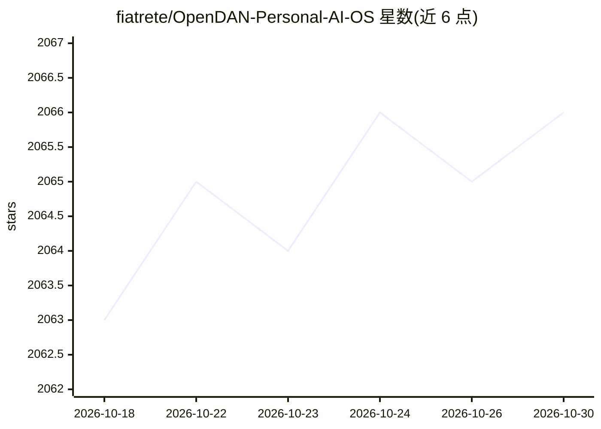

# fiatrete/OpenDAN-Personal-AI-OS

⭐ 2,066 · Python · MIT · 推送 2026-03-28 · [GitHub](https://github.com/fiatrete/OpenDAN-Personal-AI-OS) · [官网](https://opendan.ai) · 组织维护

**开源个人 AI 操作系统：本地整合运行 AI Agent 与工作流**

OpenDAN 是开源的个人 AI OS（当前 0.5.1 MVP，自称早期阶段），以 Docker 容器方式运行于 PC/Mac/树莓派/NAS，通过 AIOS Shell 与内置 Agent 对话。内置个人助理 Jarvis、信息助理 Mia、英语教师 Tracy 与 ai_bash 等 Agent，支持 Agent 编组工作流（如 story_maker 生成有声童话书）、本地知识库（文件/邮件爬取）、Telegram/Email 接入，LLM 可切换并支持本地 LLaMa。运行需 Docker 与 OpenAI API Token（或本地模型），源码安装需 Python>=3.11，可能需手动安装 ffmpeg。社区通过 SourceDAO 智能合约激励贡献。

## 筛选速览

| 维度 | 判定 | 备注 |
|---|---|---|
| AI 角色 | `ai-ecosystem` | LLM/agent 周边工具 |
| 许可风险 | `permissive` | MIT |
| 部署形态 | `self-host` | docker 或自建部署 |
| 模型依赖 | — | README 未给出锁定关系 |
| 硬件要求 | — | 无带数字的原话,不猜 |
| 安装摩擦 | `low` | 无编译、无系统依赖或容器化 |
| 成熟度 | `idea` | |

## 能力要点

- 内置多类 AI Agent（Jarvis/Mia/Tracy/ai_bash）与 Agent 协作工作流
- 基于本地文件/邮件构建私有知识库供 Agent 访问
- LLM 可切换，支持本地运行 LLaMa
- 通过 Telegram/Email 连接 AI Agent 与工作流

## 适用场景

- 在个人设备上运行私有 AI 助手管理日程与个人数据
- 让多个 Agent 协作完成复杂任务（如生成有声童话书）
- 把个人文件整理为本地知识库供 AI 查询

## 场景标签

`AI 助手` `工作流自动化` `多智能体` `知识库管理` · 领域:Agent 开发

## 证据(README 行号)

> L7: OpenDAN is an open source Personal AI OS , which consolidates various AI modules in one place for your personal use.
> L11: OpenDAN (Open and Do Anything Now with AI) is revolutionizing the AI landscape with its Personal AI Operating Syste
> L25: - [x] Rapid installation and deployment of OpenDAN based on Docker, making OpenDAN compatible with a wide range of 
> L123: 1. **AI Agent**: Driven by a large language model, having own memory.The AI Agent completes tasks through natural 

## 星数曲线

2026-10-18 2,063 → 2026-10-30 2,066（+3）

---
*卡片 v1 · prompt 1.4 · 生成 2026-10-21 · 置信度 mid · 依据 README sha `20237e7bf224` · [字段定义](../../DATASET.md)*
