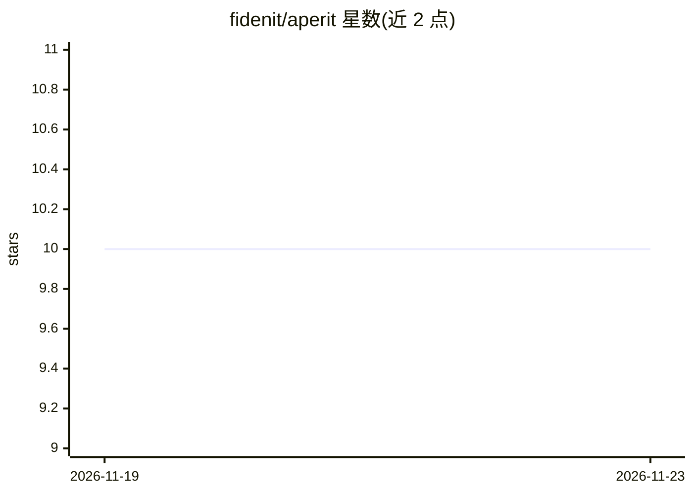

# fidenit/aperit

⭐ 10 · Rust · Apache-2.0 · 推送 2026-11-21 · [GitHub](https://github.com/fidenit/aperit) · 个人维护

**无聊天窗口的 AI 工作台：对话生成并编辑卡片看板**

APERIT 是 Windows/macOS 桌面应用，以 PATET 协议驱动：AI 逐行写出卡片操作（14 种卡片），把对话结果实时渲染为可交互看板，而非文本段落。看板按主题分组、可缩放导航；AI 可运行命令、读写文件、搜索网页、后台操作浏览器，并以 Markdown 文件保存记忆。默认接入 Claude API 或本机 Claude Code 作引擎，也支持 OpenAI 兼容端点、MCP 或 AG-UI 代理。Linux 尚未支持，路线卡数据来自 Kakao Map。

## 筛选速览

| 维度 | 判定 | 备注 |
|---|---|---|
| AI 角色 | `ai-native` | 本体是模型或模型工具 |
| 许可风险 | `permissive` | Apache-2.0 |
| 部署形态 | `desktop` | 安装包/桌面程序 |
| 模型依赖 | local-ok | 支持本地模型 |
| 硬件要求 | — | 无带数字的原话,不猜 |
| 安装摩擦 | `low` | 无编译、无系统依赖或容器化 |
| 成熟度 | `idea` | |

## 能力要点

- PATET 协议：一行一操作、14 种卡片的开放界面语言
- 『my turn』槽位集中呈现需用户确认的决策卡片
- 可运行命令、编辑文件、后台浏览器操作，长任务拆为并行 worker
- 记忆以纯 Markdown 存储，可用 Obsidian 打开

## 适用场景

- 用一句话生成带路线、日程、预算和清单的规划看板
- 把需要我拍板的事项集中到一处逐个确认
- 让 AI 在后台完成填表、浏览网页等操作，只在登录时介入
- 用自己的 MCP/AG-UI 代理把看板当作界面

## 场景标签

`AI 助手` `浏览器自动化` · 领域:效率与自动化

## 证据(README 行号)

> L27: |**PATET**|The open language an AI writes to build and edit a screen: one op per line, 14 kinds of cards, answers f
> L38: **The screen is the answer.** The AI does not write to you. It edits a board of cards, one line at a time, and you 
> L103: |Another model|an OpenAI-compatible endpoint: OpenAI, a local model behind Ollama or LM Studio, OpenRouter|APERIT'

## 星数曲线

2026-11-19 10 → 2026-11-23 10（+0）

---
*卡片 v1 · prompt 1.4 · 生成 2026-11-19 · 置信度 high · 依据 README sha `177e0a251ef8` · [字段定义](../../DATASET.md)*
