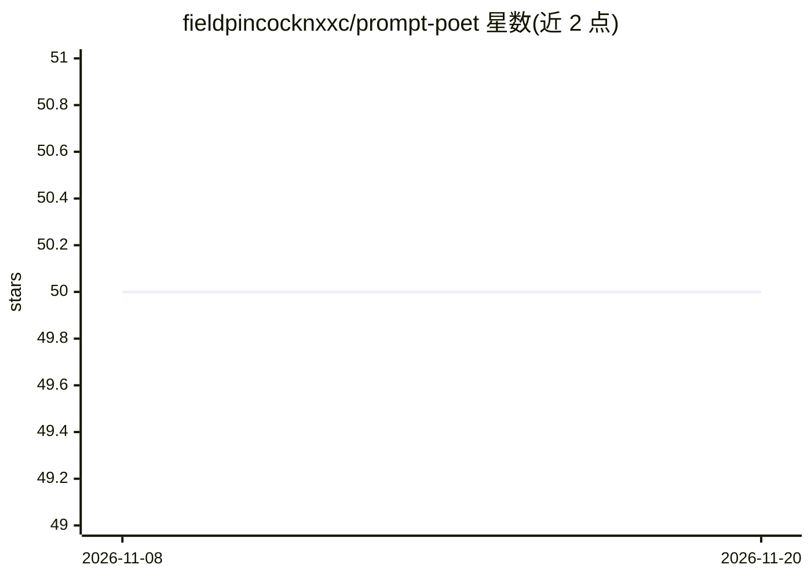

# fieldpincocknxxc/prompt-poet

⭐ 50 · Python · MIT · 推送 2026-11-05 · [GitHub](https://github.com/fieldpincocknxxc/prompt-poet) · 组织维护

**低代码 LLM 提示词模板库：YAML+Jinja2、token 计数与缓存感知截断**

面向开发者与非技术用户的 Python 提示词模板库：用 YAML+Jinja2 双阶段（渲染+加载）构建结构化、动态的提示词，支持数据绑定、模板内函数调用、列表插值、可复用 section 拆分与模板注册表（文件存储）。内置 tokenization 与截断功能，默认使用 TikToken o200k_base 分词器，可自定义 encode 函数；提供 cache-aware 截断算法以提升前缀缓存命中率，并通过嵌套 section 提供各部分 token 统计。以 pip 包形式安装。

## 筛选速览

| 维度 | 判定 | 备注 |
|---|---|---|
| AI 角色 | `ai-ecosystem` | LLM/agent 周边工具 |
| 许可风险 | `permissive` | MIT |
| 部署形态 | `library` | 以包/库形式分发 |
| 模型依赖 | — | README 未给出锁定关系 |
| 硬件要求 | — | 无带数字的原话,不猜 |
| 安装摩擦 | `low` | 无编译、无系统依赖或容器化 |
| 成熟度 | — | 结构信号不足 |

## 能力要点

- YAML+Jinja2 双阶段模板渲染，支持数据绑定与模板内 Python 函数调用
- 按截断优先级截断旧消息，cache-aware 截断提升前缀缓存命中率
- 默认 TikToken o200k_base 分词器，可自定义 encode 函数
- 嵌套 section 提供提示词各组成部分的 token 统计

## 适用场景

- 为 LLM 应用构建复杂动态提示词模板
- 聊天历史超出 token 上限时按优先级截断
- 生产环境监控提示词各部分 token 消耗
- A/B 测试时复用拆分后的模板 section

## 场景标签

`提示工程` · 领域:Agent 开发

## 证据(README 行号)

> L5: Prompt Poet streamlines and simplifies prompt design for both developers and non-technical users with its low code a
> L136: The Prompt Poet Library provides various features and settings, including prompt properties. Key features like tok

## 星数曲线

2026-11-08 50 → 2026-11-20 50（+0）

---
*卡片 v1 · prompt 1.4 · 生成 2026-11-18 · 置信度 high · 依据 README sha `7799b75c1f8f` · [字段定义](../../DATASET.md)*
