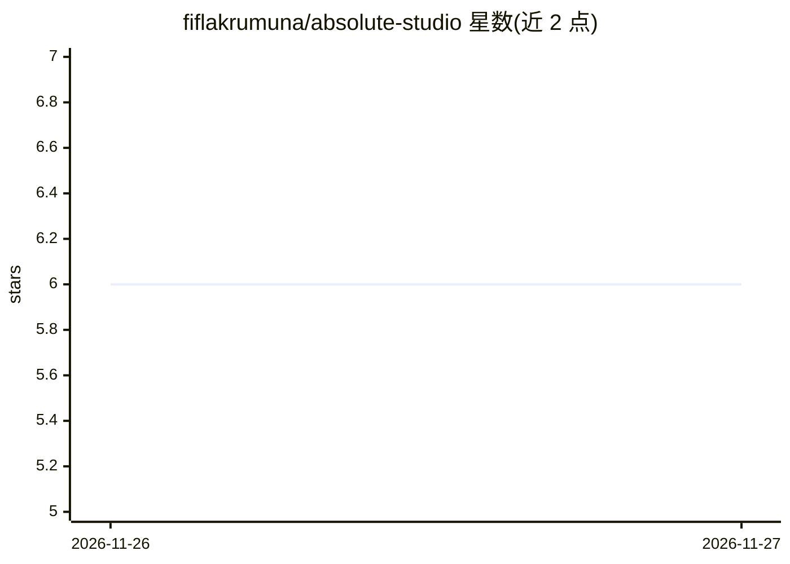

# fiflakrumuna/absolute-studio

⭐ 6 · TypeScript · GPL-3.0 · 推送 2026-11-26 · [GitHub](https://github.com/fiflakrumuna/absolute-studio) · 个人维护

**桌面端本地/云 LLM 自主编码 Agent，可编辑文件与执行终端**

基于 Tauri v2、Rust 与 React 构建的桌面应用，将本地与云端大模型接入本地文件系统和终端。用户可挂载任意项目目录，Agent 通过 list_files/search_files/read_file/write_file/edit_file/run_command 等工具读取、检索、创建与补丁式修改文件，编译运行命令并返回退出码；内置 Rust 原实现的 web_search 与 fetch_url 网页检索工具，支持本地 Ollama 离线推理与 OpenRouter/OpenAI 兼容端点。Windows 提供预编译安装包，亦可从源码构建，本地模式需另行安装 Ollama。

## 筛选速览

| 维度 | 判定 | 备注 |
|---|---|---|
| AI 角色 | `ai-native` | 本体是模型或模型工具 |
| 许可风险 | `none` | GPL-3.0 |
| 部署形态 | `desktop` | 安装包/桌面程序 |
| 模型依赖 | local-ok | 支持本地模型 |
| 硬件要求 | — | 无带数字的原话,不猜 |
| 安装摩擦 | `low` | 无编译、无系统依赖或容器化 |
| 成熟度 | — | 结构信号不足 |

## 能力要点

- 本地 Ollama 离线推理与 OpenRouter/OpenAI 兼容端点双模式
- 工作区工具集：文件读写、SEARCH/REPLACE 补丁编辑、命令执行与 EXIT_CODE 反馈
- Rust 原生 web_search/fetch_url 网页检索工具
- Token 级流式输出、GFM 渲染与 STOP/Esc 即时中断

## 适用场景

- 让 Agent 在本地项目目录内自动读取、修改代码并运行测试
- 无网络环境下用本地 Ollama 私有推理操作工作区
- 结合实时网页检索做代码研究并直接落盘改动

## 场景标签

`编码 Agent` · 领域:编码与开发

## 证据(README 行号)

> L15: **Absolute Studio** bridges local and cloud Large Language Models with your local filesystem and terminal. Unlike s
> L20:  - **Local Mode:** Native integration with **Ollama** (`qwen3.5:9b` or any locally pulled model) for 100% private, 
> L22: - **🤖 Autonomous Workspace Agent:**

## 星数曲线

2026-11-26 6 → 2026-11-27 6（+0）

---
*卡片 v1 · prompt 1.4 · 生成 2026-11-26 · 置信度 high · 依据 README sha `202b400fa629` · [字段定义](../../DATASET.md)*
