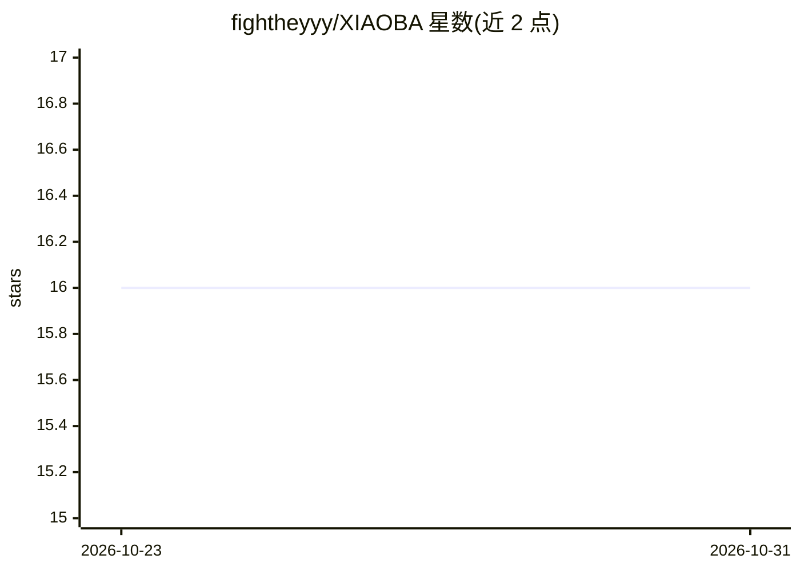

# fightheyyy/XIAOBA

⭐ 16 · TypeScript · Apache-2.0 · 推送 2026-10-29 · [GitHub](https://github.com/fightheyyy/XIAOBA) · 个人维护 · 中文 README

**开源 Personal Agent：有记忆、会跟进、能执行实际任务**

面向个人用户的开源 Personal Agent 运行时（Node.js，Apache-2.0）。由 Base 主 Agent 与八个专业角色（代码、浏览器、macOS 桌面、飞书等）协作执行任务，支持会话记忆保存为本地 Markdown、定时提醒与跟进。模型可接入 OpenAI-compatible、Anthropic 或本地 Ollama；Gmail、Notion、GitHub 通过官方 API 连接。内置 Trace 记录、Case 重放与角色评测机制。限制：GuiCat 仅支持 macOS，Windows 受限执行返回 blocked，桌面包为 v0.2.2 预览版且未签名。

## 筛选速览

| 维度 | 判定 | 备注 |
|---|---|---|
| AI 角色 | `ai-native` | 本体是模型或模型工具 |
| 许可风险 | `permissive` | Apache-2.0 |
| 部署形态 | `library` | 以包/库形式分发 |
| 模型依赖 | local-ok | 支持本地模型 |
| 硬件要求 | — | 无带数字的原话,不猜 |
| 安装摩擦 | `low` | 无编译、无系统依赖或容器化 |
| 成熟度 | `idea` | |

## 能力要点

- Base Agent + 8 个专业角色的多角色协作（代码/浏览器/macOS 桌面/飞书）
- 记忆保存为本地 Markdown，支持定时提醒与在原对话中跟进
- 可接入 OpenAI-compatible、Anthropic 或本地 Ollama
- Trace 记录、Case 重放与 Test+Eval 验收的受控进化机制

## 适用场景

- 让 AI 接手改代码、跑构建并带回验证结果
- 浏览网页收集资料并核验页面信息
- 处理飞书消息、日历、任务与文档
- 设置提醒让 Agent 定时检查任务进展

## 场景标签

`多智能体` `GUI 自动化` `AI 助手` · 领域:Agent 开发

## 证据(README 行号)

> L5: **有记忆、会跟进、能做事的开源 Personal Agent。**
> L7: 持续和它对话，让它记住你的偏好，接手任务，并按约定提醒和跟进。通过 CLI、飞书、微信或桌面使用，结果、文件和提醒回到发起工作的对话中。
> L19: **接手实际工作。** 代码、浏览器、macOS 桌面与飞书工具由专业角色执行，XiaoBa 负责沟通和派工，把结果与文件带回来。猫形的眼神和动作会随运行状态变化。

## 星数曲线

2026-10-23 16 → 2026-10-31 16（+0）

---
*卡片 v1 · prompt 1.4 · 生成 2026-10-30 · 置信度 high · 依据 README sha `96556992855d` · [字段定义](../../DATASET.md)*
