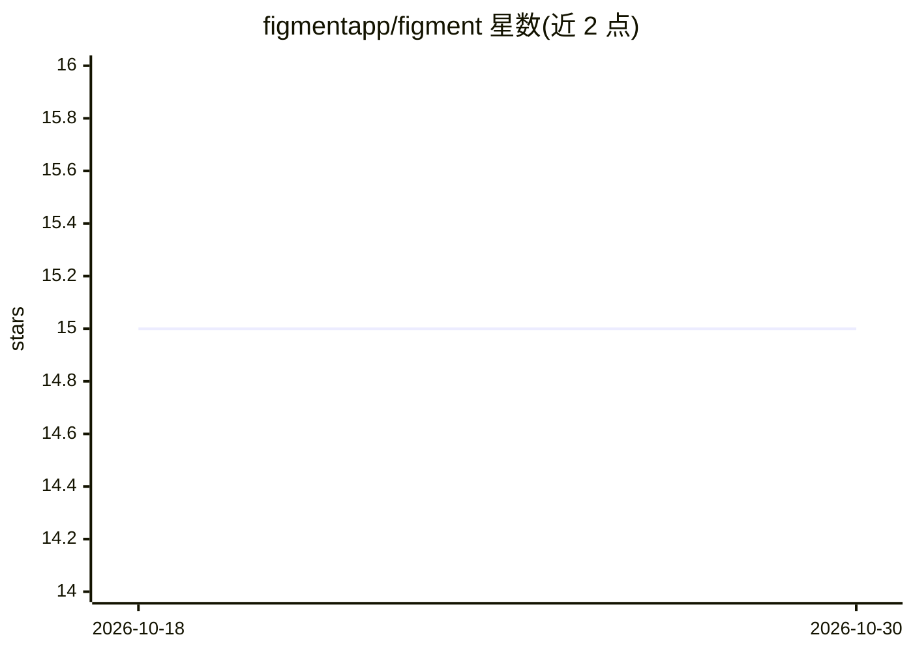

# figmentapp/figment

⭐ 15 · JavaScript · GPL-2.0 · 推送 2026-10-22 · [GitHub](https://github.com/figmentapp/figment) · [官网](https://figmentapp.com/) · 组织维护

**为创作类 AI 应用准备数据的节点式图形桌面应用**

基于 Electron（JavaScript/React）的图形化节点应用，用于对数据进行整理和转换，以便输入创作类 AI 应用；README 描述其适合处理大型数据集、内置 ML 任务与创作性操作。面向使用者提供下载页获取最新发布版，另有教程与节点参考文档；开发者可克隆仓库后用 npm install 安装依赖并以 npm start 启动。采用 GPL 2.0 许可证分发。

## 筛选速览

| 维度 | 判定 | 备注 |
|---|---|---|
| AI 角色 | `ai-ecosystem` | LLM/agent 周边工具 |
| 许可风险 | `viral` | GPL-2.0 |
| 部署形态 | `library` | 以包/库形式分发 |
| 模型依赖 | — | README 未给出锁定关系 |
| 硬件要求 | — | 无带数字的原话,不猜 |
| 安装摩擦 | `low` | 无编译、无系统依赖或容器化 |
| 成熟度 | — | 结构信号不足 |

## 能力要点

- 节点式图形界面进行数据整理与转换
- 支持处理大型数据集与内置 ML 任务
- Electron + JavaScript/React 构建，提供桌面发布版下载

## 适用场景

- 把数据整理成适合输入创作类 AI 应用的格式
- 通过节点流程对大型数据集执行处理与创作性操作

## 场景标签

`图像视频处理` · 领域:感知与多模态

## 证据(README 行号)

> L9: Figment is a **graphical node-based app** for preparing data for feeding into creative AI applications. It helps you
> L13: Figment is an Electron app written in JavaScript and React.

## 星数曲线

2026-10-18 15 → 2026-10-30 15（+0）

---
*卡片 v1 · prompt 1.4 · 生成 2026-10-30 · 置信度 mid · 依据 README sha `4269fd623f23` · [字段定义](../../DATASET.md)*
