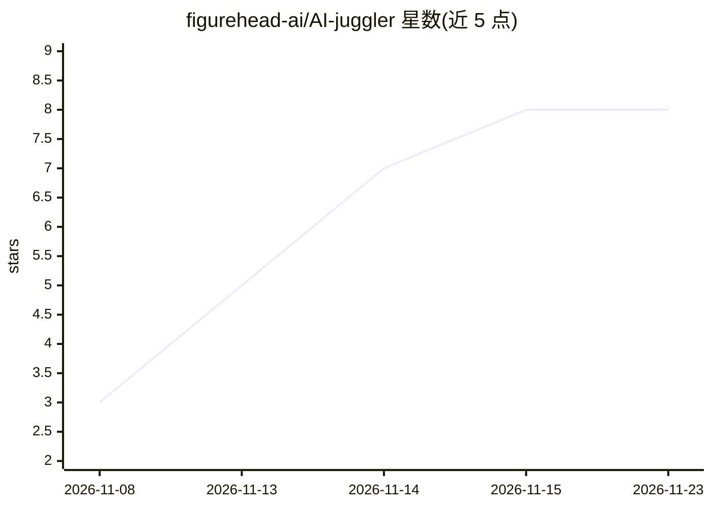

# figurehead-ai/AI-juggler

⭐ 8 · Rust · MIT · 推送 2026-11-22 · [GitHub](https://github.com/figurehead-ai/AI-juggler) · [官网](https://figurehead.ai/ai-juggler) · 个人维护

**为 macOS 开发者集中管理多个 AI 编码工具会话与账号额度的桌面应用**

Rust + Tauri 构建的 macOS 本地应用，把用户已装的 Claude Code、Codex 等编码工具的会话、账号与配置集中到一个窗口：列出当前打开的会话并可一键跳转、按 profile 管理工具配置副本、读取工具自身记录展示用量与限额、额度不足时把对话迁移到另一账号或工具，并提供会话历史搜索、MCP 服务器与规则文件比对、进程内存/CPU 监控与清理。MIT 开源，不代理流量、不代登录、不存凭据；依赖系统 PATH 查找工具。

## 筛选速览

| 维度 | 判定 | 备注 |
|---|---|---|
| AI 角色 | `ai-ecosystem` | LLM/agent 周边工具 |
| 许可风险 | `permissive` | MIT |
| 部署形态 | `desktop` | 安装包/桌面程序 |
| 模型依赖 | — | README 未给出锁定关系 |
| 硬件要求 | — | 无带数字的原话,不猜 |
| 安装摩擦 | `low` | 无编译、无系统依赖或容器化 |
| 成熟度 | — | 结构信号不足 |

## 能力要点

- 集中列出 Claude app/终端/Codex app/Cursor 中打开的会话，一键跳转
- 从工具自身记录读取用量与限额，未测量时显示 'Not measured yet'
- 额度不足时把对话迁移到另一账号或工具（beta）
- 会话历史按内容搜索，规则文件与 MCP 服务器跨工具比对

## 适用场景

- 同时持有多个 Claude/Codex 订阅，需要追踪各账号剩余额度
- 在多个工具和配置目录间切换编码会话
- 盘点本机 AI 工具的内存/CPU 占用并清理残留进程

## 场景标签

 · 领域:开发者工具/AI 编码工作流

## 证据(README 行号)

> L5: Free and open source (MIT), local-first, for macOS. AI Juggler works with the
> L24: - **What's open, where, and one step to it.** The list shows the sessions
> L127: |**Claude Code** (the `claude` command)|Sessions, usage, limits, starting sessions, switching (beta)|

## 星数曲线

2026-11-08 3 → 2026-11-23 8（+5）

---
*卡片 v1 · prompt 1.4 · 生成 2026-11-20 · 置信度 high · 依据 README sha `42980e54945a` · [字段定义](../../DATASET.md)*
