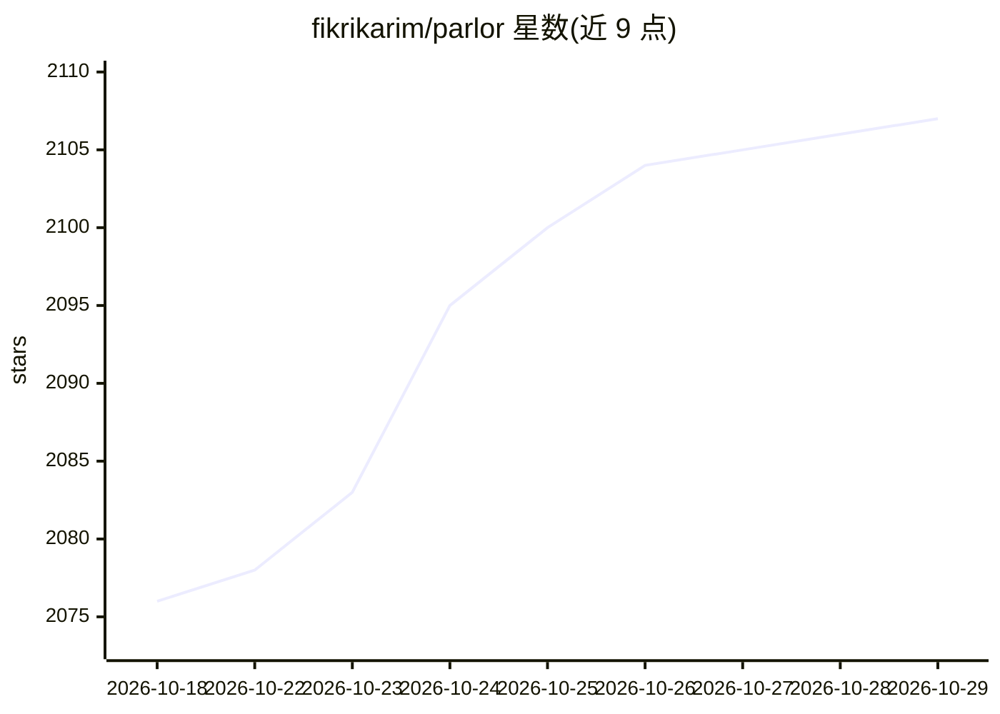

# fikrikarim/parlor

⭐ 2,107 · Python · Apache-2.0 · 推送 2026-08-03 · [GitHub](https://github.com/fikrikarim/parlor) · 个人维护

**本地全离线实时多模态语音 AI 应用（类 GPT-Live）**

在 Apple Silicon Mac 或带 GPU 的 Linux 上完全本地运行的实时多模态对话应用：浏览器采集麦克风音频与摄像头 JPEG 帧，经 WebSocket 送到 FastAPI 服务端，由 llama.cpp 运行 Gemma 4 多模态模型处理，流式输出转录与逐句 TTS。功能包括免按键轮流对话（Silero VAD + Pipecat smart-turn 判断）、打断、定时器、同声翻译模式、只听模式，以及可选的经 OpenAI 兼容端点（默认 OpenRouter）的后台研究。作者自述为研究预览版早期实验，需 Python 3.12+、llama.cpp 构建 b9503+ 与约 6GB 空闲内存。

## 筛选速览

| 维度 | 判定 | 备注 |
|---|---|---|
| AI 角色 | `ai-native` | 本体是模型或模型工具 |
| 许可风险 | `permissive` | Apache-2.0 |
| 部署形态 | `None` |  |
| 模型依赖 | — | README 未给出锁定关系 |
| 硬件要求 | — | 无带数字的原话,不猜 |
| 安装摩擦 | `low` | 无编译、无系统依赖或容器化 |
| 成熟度 | `idea` | |

## 能力要点

- 浏览器音频+摄像头多模态输入，全程本地运行
- 免按键轮流对话、可语音打断的实时流式回复
- 定时器/翻译/只听等模式经独立语法约束 JSON 请求实现，控制标记不进入语音
- 可选后台研究任务交给 OpenAI 兼容端点（默认 OpenRouter），不设 key 则保持全离线

## 适用场景

- 在自家 Mac 上跑一个不联网的语音对话助手
- 练英语口语或做实时口译练习
- 体验带摄像头视觉输入的本地实时多模态 AI

## 场景标签

`语音 Agent` `多模态` · 领域:对话与助手

## 证据(README 行号)

> L3: Fully on-device, real-time multimodal AI, with features similar to GPT-Live.
> L26: Browser (mic + camera)
> L34: - **Everything streams.** The reply opens with a transcript of what was heard (on screen immediately — committing t

## 星数曲线

2026-10-18 2,076 → 2026-10-29 2,107（+31）

---
*卡片 v1 · prompt 1.4 · 生成 2026-10-21 · 置信度 high · 依据 README sha `ad04e194ac85` · [字段定义](../../DATASET.md)*
