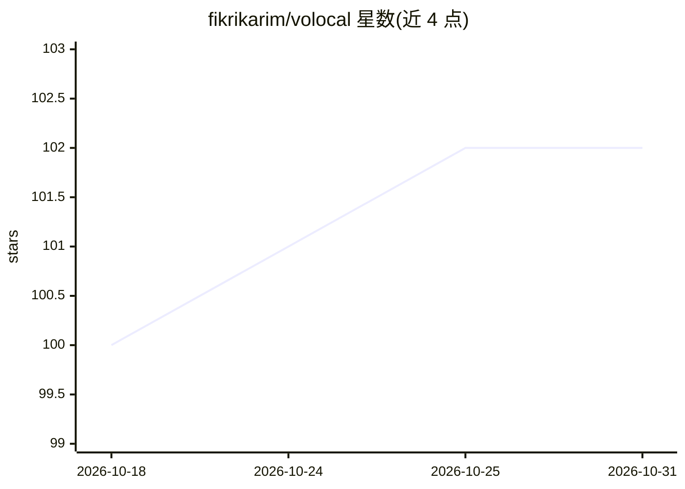

# fikrikarim/volocal

⭐ 102 · Swift · MIT · 推送 2026-04-02 · [GitHub](https://github.com/fikrikarim/volocal) · [官网](https://apps.apple.com/app/volocal/id6761493288) · 个人维护

**iOS 端完全本地运行的实时语音 AI 应用**

面向 iPhone 用户的离线语音对话应用：STT→LLM→TTS 全链路在设备上实时流式运行，无需云端或 API key。关键机制是将三个模型分散到不同计算单元——Parakeet EOU 走 Neural Engine（CoreML）、Qwen3.5-2B 走 GPU（llama.cpp/Metal）、PocketTTS 走 CPU+GPU，避免资源争用；共享 AVAudioEngine 加硬件回声消除支持打断对话。首启需下载约 2.3 GB 模型，运行内存约 1.2 GB。App Store 提供下载，也可用 XcodeGen 从源码构建（仅限真机，模拟器无 Neural Engine）。README 自述为进行中项目，可能有 bug。

## 筛选速览

| 维度 | 判定 | 备注 |
|---|---|---|
| AI 角色 | `ai-native` | 本体是模型或模型工具 |
| 许可风险 | `permissive` | MIT |
| 部署形态 | `None` |  |
| 模型依赖 | — | README 未给出锁定关系 |
| 硬件要求 | — | 无带数字的原话,不猜 |
| 安装摩擦 | `low` | 无编译、无系统依赖或容器化 |
| 成熟度 | `idea` | |

## 能力要点

- STT/LLM/TTS 三模型全离线实时流式运行
- 三模型分别部署于 Neural Engine/GPU/CPU 避免硬件争用
- 支持句中打断（barge-in）与硬件回声消除
- PocketTTS 支持 5 秒音频的声音克隆

## 适用场景

- 在 iPhone 上离线进行实时语音对话，不产生服务器费用
- 无网络或注重隐私场景下的英语口语练习
- 作为端侧多模型协同调度的参考实现

## 场景标签

`语音 Agent` · 领域:对话与助手

## 证据(README 行号)

> L3: Fully local voice AI for iOS. No cloud, no API keys, no internet after setup.
> L5: STT → LLM → TTS, streaming in real-time on your iPhone.
> L24: - Real-time voice conversations

## 星数曲线

2026-10-18 100 → 2026-10-31 102（+2）

---
*卡片 v1 · prompt 1.4 · 生成 2026-10-23 · 置信度 high · 依据 README sha `e4e42f499cf5` · [字段定义](../../DATASET.md)*
