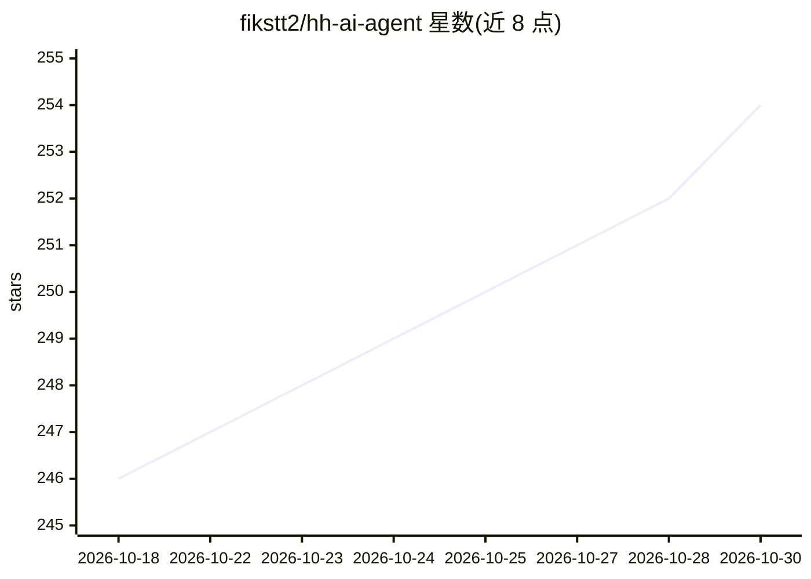

# fikstt2/hh-ai-agent

⭐ 254 · Python · MIT · 推送 2026-09-28 · [GitHub](https://github.com/fikstt2/hh-ai-agent) · 个人维护

**HH.ru 求职自动应答机器人：LLM 筛选职位并生成求职信**

面向求职者的 Python 自动化 agent：在 HH.ru 搜索职位，经 CloakBrowser/Playwright 抓取页面，用 LLM（Ollama 本地、Mistral API 或任意 OpenAI-compatible 端点）评估匹配度并生成求职信，通过 Telegram 推送。支持 dry_run/approval/auto 三种模式，自动应答需三项配置同时开启，受批次大小、日上限、匹配阈值（默认 ≥85%）与 circuit breaker 约束。需 Python 3.11+、Telegram Bot，setup_wizard.py 交互式生成 .env 与 profile.yaml。README 明示自动化可能违反 HH.ru 用户协议，风险由用户承担。

## 筛选速览

| 维度 | 判定 | 备注 |
|---|---|---|
| AI 角色 | `ai-native` | 本体是模型或模型工具 |
| 许可风险 | `permissive` | MIT |
| 部署形态 | `None` |  |
| 模型依赖 | local-ok | 支持本地模型 |
| 硬件要求 | — | 无带数字的原话,不猜 |
| 安装摩擦 | `low` | 无编译、无系统依赖或容器化 |
| 成熟度 | — | 结构信号不足 |

## 能力要点

- LLM 评估职位匹配度并生成求职信，Telegram 按钮式人工确认
- 支持 Ollama 本地 / Mistral API / 任意 OpenAI-compatible 端点
- 自动应答默认关闭，受日限额、工作窗口与 circuit breaker 约束
- SQLite 状态管理与单实例锁，测试不触达外部服务

## 适用场景

- 自动搜索并筛选 HH.ru 上与我匹配的职位
- 让 LLM 生成附求职信的应答，经我在 Telegram 确认后发送
- 用本地 Ollama 模型处理职位与个人资料，避免数据外发

## 场景标签

`浏览器自动化` `网页抓取` `AI 写作` · 领域:效率与自动化

## 证据(README 行号)

> L3: Агент автоматически ищет вакансии на HH.ru, оценивает их через LLM, генерирует сопроводительные письма и присылает п
> L15: 2. Какой AI-провайдер использовать (Ollama локально, Mistral API или любой OpenAI-compatible)

## 星数曲线

2026-10-18 246 → 2026-10-30 254（+8）

---
*卡片 v1 · prompt 1.4 · 生成 2026-10-22 · 置信度 high · 依据 README sha `2251a1a1bb99` · [字段定义](../../DATASET.md)*
