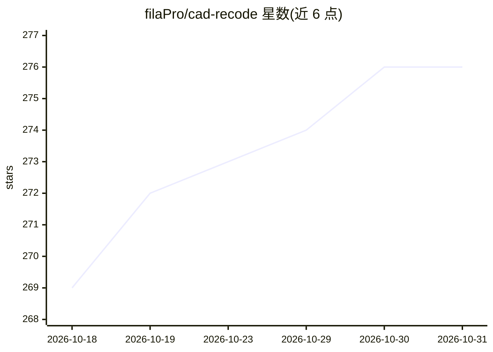

# filaPro/cad-recode

⭐ 276 · Jupyter Notebook · NOASSERTION · 推送 2025-11-16 · [GitHub](https://github.com/filaPro/cad-recode) · 组织维护

**从点云逆向生成 CAD Python 代码的研究方法实现**

ICCV 2025 论文 CAD-Recode 的官方实现：将 3D 点云转换为以 CadQuery Python 代码形式表达的 CAD 模型。方法基于 Qwen2-1.5B 训练，保留原 tokenizer 并新增单个线性层。仓库提供简单推理示例，安装方式为按 Dockerfile 安装 Python 依赖后在 Jupyter 中运行 demo.ipynb。作者来自卢森堡大学，附模型、数据集与 HuggingFace Space 链接。

## 筛选速览

| 维度 | 判定 | 备注 |
|---|---|---|
| AI 角色 | `ai-native` | 本体是模型或模型工具 |
| 许可风险 | `none` | NOASSERTION |
| 部署形态 | `self-host` | docker 或自建部署 |
| 模型依赖 | — | README 未给出锁定关系 |
| 硬件要求 | — | 无带数字的原话,不猜 |
| 安装摩擦 | `low` | 无编译、无系统依赖或容器化 |
| 成熟度 | — | 结构信号不足 |

## 能力要点

- 点云→CadQuery Python 代码的 CAD 逆向生成
- 基于 Qwen2-1.5B，保留原 tokenizer 并新增单一线性层
- 在 DeepCAD/Fusion360/CC3D 三个基准上报告结果（v1 时点）

## 适用场景

- 从扫描点云重建参数化 CAD 模型
- 复现论文实验或运行推理 demo
- 作为点云到代码生成的基线方法参考

## 场景标签

`代码生成` · 领域:编码与开发

## 证据(README 行号)

> L13: This repository contains an implementation of CAD-Recode, a 3D CAD reverse engineering method introduced in our pap
> L27: CAD-Recode transforms point cloud to 3D CAD model in form of Python code (CadQuery library). CAD-Recode is trained 

## 星数曲线

2026-10-18 269 → 2026-10-31 276（+7）

---
*卡片 v1 · prompt 1.4 · 生成 2026-10-22 · 置信度 high · 依据 README sha `a462aedf378d` · [字段定义](../../DATASET.md)*
