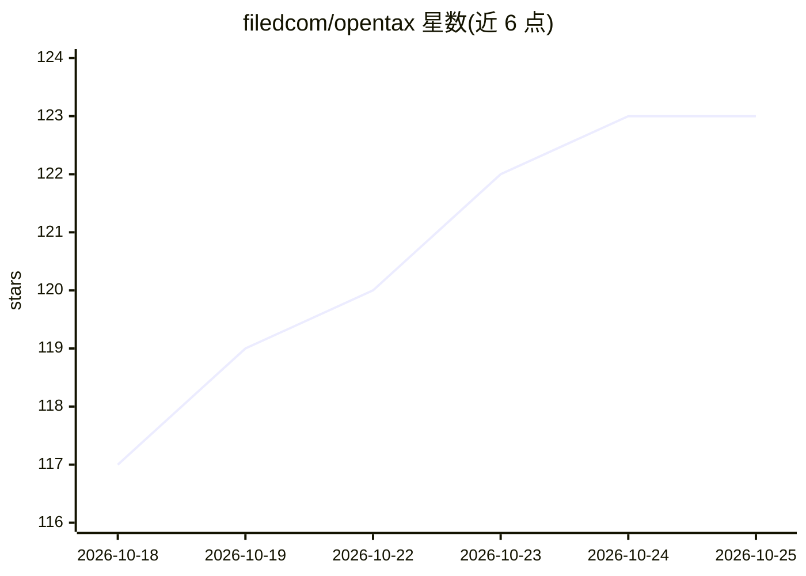

# filedcom/opentax

⭐ 123 · TypeScript · AGPL-3.0 · 推送 2026-10-23 · [GitHub](https://github.com/filedcom/opentax) · [官网](https://opentax.filed.com) · 组织维护

**供 AI 代理与开发者调用的开源美国联邦税计算引擎**

单二进制 CLI 的美国联邦税计算引擎，覆盖 TY2025 Form 1040（195 个输入节点）并开始 TY2026 1040 与 Form 4868；以 IRS 官方出版物为唯一事实来源，采用节点有向图与纯函数架构，137 个基准用例对照 IRS 引用值校验。支持创建/校验申报单、离线执行 IRS MeF 业务规则、导出提交 ZIP，数据全部存本地。代码库由 AI 代理在自主循环中维护，提供 Claude Desktop/Claude Code 技能与插件接入方式。限制：不含州税表单，非正式报税工具。

## 筛选速览

| 维度 | 判定 | 备注 |
|---|---|---|
| AI 角色 | `ai-enhanced` | 去掉 AI 部分产品仍成立 |
| 许可风险 | `dual` | AGPL-3.0 |
| 部署形态 | `desktop` | 安装包/桌面程序 |
| 模型依赖 | — | README 未给出锁定关系 |
| 硬件要求 | — | 无带数字的原话,不猜 |
| 安装摩擦 | `low` | 无编译、无系统依赖或容器化 |
| 成熟度 | — | 结构信号不足 |

## 能力要点

- 单二进制 CLI，无运行时依赖，macOS/Linux/Windows 可用
- 137 个 TY2025 基准用例对照 IRS 出版物引用值校验
- 节点纯函数有向图架构，Zod schema 校验
- 离线执行 IRS MeF 业务规则并生成提交 ZIP

## 适用场景

- AI 代理作为计算器调用，完成美国联邦税申报单计算
- 开发者集成联邦税计算能力到自己的应用
- 离线校验申报单是否符合 IRS MeF 业务规则

## 场景标签

 · 领域:财税/开发者工具

## 证据(README 行号)

> L21: - Built to be run by AI agents more than humans
> L25: Inspired by Andrej Karpathy's autoresearch, an autonomous loop where AI agents modify code, measure results, and ke
> L175: AI agents maintain the codebase: they read IRS instructions, write nodes, source

## 星数曲线

2026-10-18 117 → 2026-10-25 123（+6）

---
*卡片 v1 · prompt 1.4 · 生成 2026-10-23 · 置信度 high · 依据 README sha `e59e4d35b93f` · [字段定义](../../DATASET.md)*
