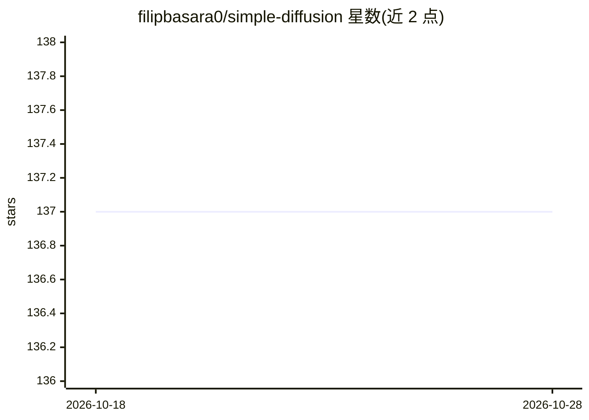

# filipbasara0/simple-diffusion

⭐ 137 · Python · MIT · 推送 2025-12-05 · [GitHub](https://github.com/filipbasara0/simple-diffusion) · 个人维护

**PyTorch 极简去噪扩散模型实现，无条件图像生成**

PyTorch 编写的极简去噪扩散概率模型（DDPM/DDIM）实现：包含 DDIM 调度器与带残差连接和 Attention 层的 UNet 架构，用于无条件图像生成。作者在小规模模型（约 234 万参数）上以 Oxford Flowers 数据集做训练实验，记录了 40k 步训练配置、GTX 1070Ti 约 6 小时的训练时长及关于残差连接、Attention、归一化与学习率的实验结论。README 给出 train.py 训练命令，未提供安装包或 Docker。

## 筛选速览

| 维度 | 判定 | 备注 |
|---|---|---|
| AI 角色 | `ai-native` | 本体是模型或模型工具 |
| 许可风险 | `permissive` | MIT |
| 部署形态 | `None` |  |
| 模型依赖 | — | README 未给出锁定关系 |
| 硬件要求 | — | 无带数字的原话,不猜 |
| 安装摩擦 | `low` | 无编译、无系统依赖或容器化 |
| 成熟度 | — | 结构信号不足 |

## 能力要点

- DDIM 调度器与带残差连接、Attention 层的 UNet 实现
- 在 Oxford Flowers 数据集上完成训练实验并记录超参数与结论
- 提供 train.py 命令行训练入口

## 适用场景

- 学习扩散模型的最小实现结构
- 复现小模型在 Oxford Flowers 上的生成实验
- 作为自定义数据集扩散训练的起点

## 场景标签

`图像生成` · 领域:内容生成

## 证据(README 行号)

> L3: A minimal implementation of a denoising diffusion uncoditional image generation model in PyTorch.
> L6: Includes the DDIM scheduler and the UNet architecture with residual connections and Attention layers.

## 星数曲线

2026-10-18 137 → 2026-10-28 137（+0）

---
*卡片 v1 · prompt 1.4 · 生成 2026-10-22 · 置信度 high · 依据 README sha `348d4145f5c0` · [字段定义](../../DATASET.md)*
