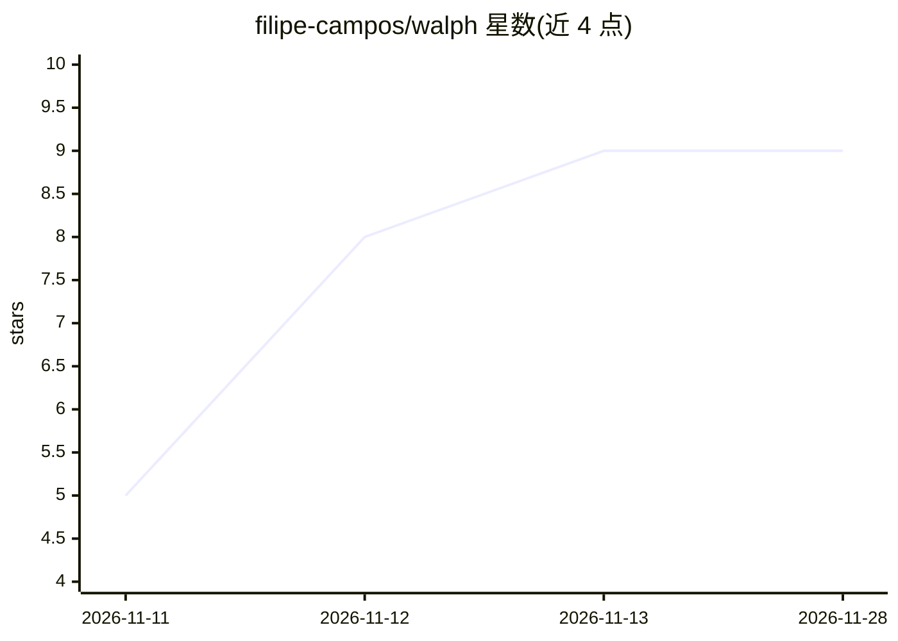

# filipe-campos/walph

⭐ 9 · TypeScript · MIT · 推送 2026-11-25 · [GitHub](https://github.com/filipe-campos/walph) · [官网](https://filipe-campos.github.io/walph) · 个人维护

**内建 Claude Code 面板的跨平台桌面 IDE**

基于 Electron 的桌面 IDE，把 Claude Code 面板内建到编辑器旁：以工作区标签在单窗口管理多个项目，显示每个工作区中 Claude 会话状态（运行中/完成/等待/失败），后台会话结束或请求权限时给出 toast 与系统通知。编辑器基于 CodeMirror 6，支持 LSP 补全、Git 操作、ripgrep 全局搜索、xterm.js 终端与 Docker 管理。Claude 面板经由 Claude Agent SDK 运行，需用户自己的 Claude 账号或 Anthropic API key；IDE 其余功能不依赖它。

## 筛选速览

| 维度 | 判定 | 备注 |
|---|---|---|
| AI 角色 | `ai-enhanced` | 去掉 AI 部分产品仍成立 |
| 许可风险 | `permissive` | MIT |
| 部署形态 | `desktop` | 安装包/桌面程序 |
| 模型依赖 | locked-api |  |
| 硬件要求 | — | 无带数字的原话,不猜 |
| 安装摩擦 | `low` | 无编译、无系统依赖或容器化 |
| 成熟度 | — | 结构信号不足 |

## 能力要点

- 单窗口多工作区标签，逐项目显示 Claude 会话状态与未读计数
- Claude Code 面板：diff 接受/拒绝、权限模式、斜杠命令、多会话与检查点回退
- CodeMirror 编辑器 + LSP、Git、ripgrep 搜索、终端与 Docker 管理界面
- 支持在 IDE 内查看/管理 MCP 服务器，复用既有 ~/.claude 配置

## 适用场景

- 同时推进多个项目的 Claude Code 代理任务并跟踪状态
- 在编辑器旁审阅代理提出的代码修改（diff 接受/拒绝）
- 用自然语言让代理排查不健康的容器
- 需要一个键盘优先、带 LSP 与 Git 的轻量桌面编辑器

## 场景标签

`编码 Agent` · 领域:编码与开发

## 证据(README 行号)

> L46: Most editors bolt AI on as an extension. Walph was built from scratch around the way you actually work with an agen
> L149: `~/.claude` setup, `CLAUDE.md`, skills, MCP servers and hooks are used as is. Everything else in Walph works witho
> L155: ## Build from source

## 星数曲线

2026-11-11 5 → 2026-11-28 9（+4）

---
*卡片 v1 · prompt 1.4 · 生成 2026-11-20 · 置信度 mid · 依据 README sha `cc7ad75f2a71` · [字段定义](../../DATASET.md)*
