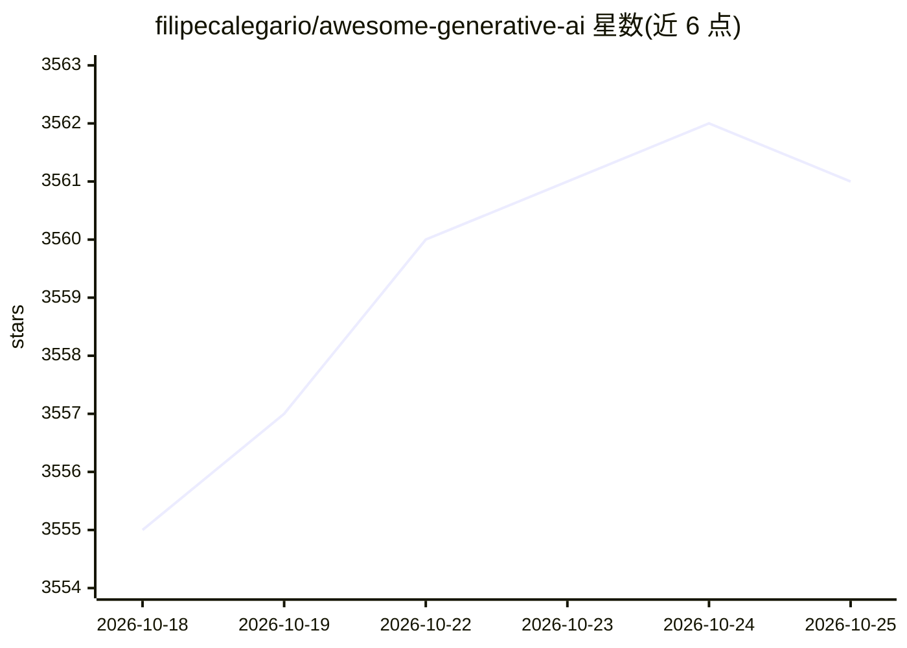

# filipecalegario/awesome-generative-ai

⭐ 3,561 · CC0-1.0 · 推送 2025-12-18 · [GitHub](https://github.com/filipecalegario/awesome-generative-ai) · 个人维护

**生成式 AI 资源策展清单：论文、工具、模型与教程聚合**

由个人维护的 Awesome 类生成式 AI 参考资源清单，收录学术论文、技术文章、在线课程、教程与软件等来源。条目按类别（LLM、提示工程、图像合成、教育资源等）组织为分节结构，各节内按时间倒序排列，新增类别成为独立子节。README 声明定期更新，接受社区 Pull Request 贡献。可见部分覆盖生成式 AI 历史与时间线、伦理与哲学讨论两个类别，含中英文与葡文条目。

## 筛选速览

| 维度 | 判定 | 备注 |
|---|---|---|
| AI 角色 | `ai-knowledge` | 知识聚合/清单类 |
| 许可风险 | `viral` | CC0-1.0 |
| 部署形态 | `None` |  |
| 模型依赖 | — | README 未给出锁定关系 |
| 硬件要求 | — | 无带数字的原话,不猜 |
| 安装摩擦 | `low` | 无编译、无系统依赖或容器化 |
| 成熟度 | — | 结构信号不足 |

## 能力要点

- 按类别分节组织生成式 AI 论文、工具、模型与教程
- 各节内条目按时间倒序排列
- 接受社区 Pull Request 贡献并定期更新

## 适用场景

- 查找生成式 AI 各领域的论文与工具资源
- 跟踪生成式 AI 领域的历史脉络与时间线
- 了解生成式 AI 相关的伦理与哲学讨论文章

## 场景标签

`精选清单` · 领域:学习与行业

## 证据(README 行号)

> L9: Welcome to our Awesome List of Generative AI resources! This repository is a curated collection of references in the
> L13: 1. **Sections**: Each section represents a different Generative AI-related category (e.g., LLMs, prompt engineering

## 星数曲线

2026-10-18 3,555 → 2026-10-25 3,561（+6）

---
*卡片 v1 · prompt 1.4 · 生成 2026-10-20 · 置信度 high · 依据 README sha `8b76d667faa5` · [字段定义](../../DATASET.md)*
