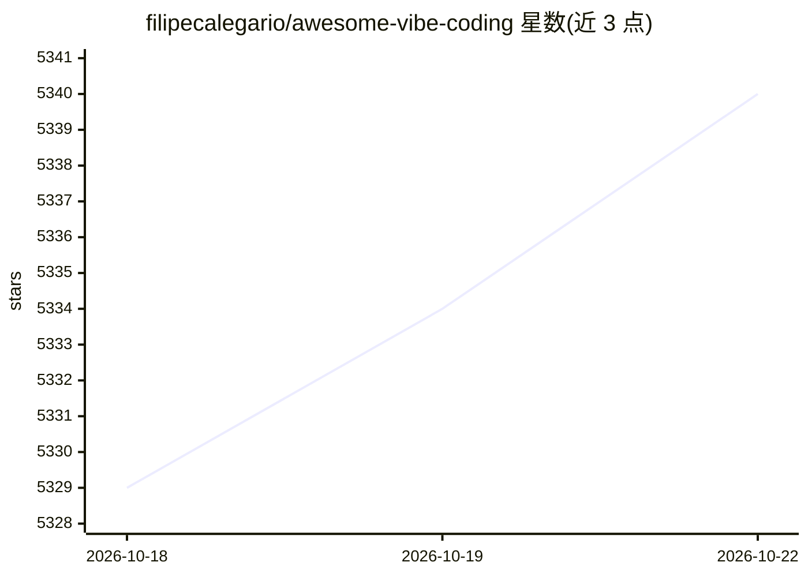

# filipecalegario/awesome-vibe-coding

⭐ 5,340 · CC0-1.0 · 推送 2026-04-16 · [GitHub](https://github.com/filipecalegario/awesome-vibe-coding) · 个人维护 · 中文 README

**vibe coding 参考资源策展清单：协作式 AI 编程工具与资料汇总**

由 filipecalegario 维护的 awesome list，收录与 AI 协作编程（vibe coding）相关的参考资源。内容包括 Karpathy 概念起源与 Wikipedia 等背景资料，以及按类别组织的工具清单：浏览器端应用构建器（Lovable、Bolt.new、v0 等）、IDE 与编辑器（Cursor、Windsurf 等）、插件扩展、本地应用、命令行工具、AI 编码任务管理、提示模板与文档规范（AGENTS.md、llms.txt 等）。README 提供英/葡/韩/中/日多语言链接。

## 筛选速览

| 维度 | 判定 | 备注 |
|---|---|---|
| AI 角色 | `ai-knowledge` | 知识聚合/清单类 |
| 许可风险 | `viral` | CC0-1.0 |
| 部署形态 | `None` |  |
| 模型依赖 | — | README 未给出锁定关系 |
| 硬件要求 | — | 无带数字的原话,不猜 |
| 安装摩擦 | `low` | 无编译、无系统依赖或容器化 |
| 成熟度 | — | 结构信号不足 |

## 能力要点

- 按浏览器工具/IDE/插件/CLI/任务管理/文档等类别组织条目
- 收录概念起源资料（Karpathy 原帖、Wikipedia、路线图）
- 覆盖开源与商业 AI 编程工具及提示模板、文档规范资源

## 适用场景

- 挑选 AI 编程工具前先浏览分类清单比较可选项
- 了解 vibe coding 概念的起源与演变资料
- 查找提示模板、AGENTS.md 等编码 agent 配套规范资源

## 场景标签

`精选清单` · 领域:学习与行业

## 证据(README 行号)

> L1: # Awesome Vibe Coding Awesome
> L3: > A curated list of vibe coding references, collaborating with AI to write code.

## 星数曲线

2026-10-18 5,329 → 2026-10-22 5,340（+11）

---
*卡片 v1 · prompt 1.4 · 生成 2026-10-20 · 置信度 high · 依据 README sha `c6658dbc81af` · [字段定义](../../DATASET.md)*
