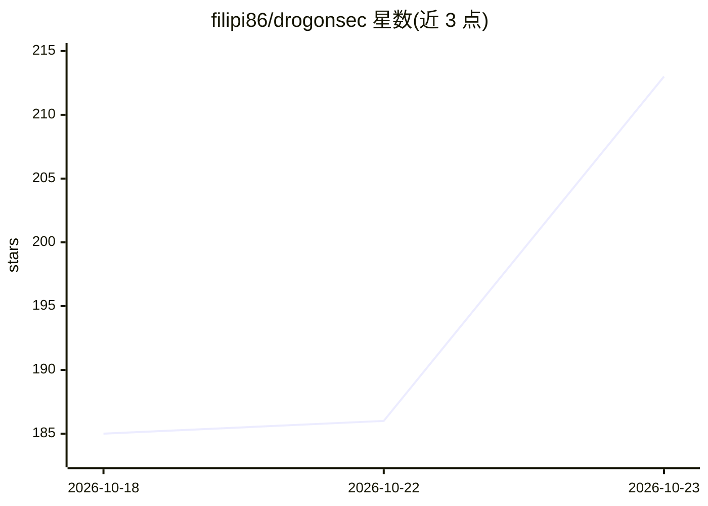

# filipi86/drogonsec

⭐ 213 · Go · NOASSERTION · 推送 2026-10-19 · [GitHub](https://github.com/filipi86/drogonsec) · [官网](https://cross-intel.com/opensource/drogonsec) · 组织维护

**开源安全扫描器：SAST/SCA/密钥检测/IaC 分析并给出 AI 修复建议**

用 Go 编写的 CLI 安全扫描器，面向开发者与 CI/CD 流水线，集成四类引擎：SAST（20+ 语言）、SCA（读取锁文件与已安装依赖树的全量传递依赖，覆盖 8 个生态）、50+ 模式的密钥泄露检测、IaC 错误配置检测（Terraform/Kubernetes），并按 OWASP Top 10:2025 分类规则。AI 用于对检出漏洞生成上下文感知的修复建议，推荐本地 Ollama+DeepSeek Coder，也支持 Anthropic 等 API 及任意 OpenAI 兼容端点。输出 Text/JSON/SARIF/CycloneDX SBOM，支持 Docker 运行，Apache 2.0 许可。

## 筛选速览

| 维度 | 判定 | 备注 |
|---|---|---|
| AI 角色 | `ai-enhanced` | 去掉 AI 部分产品仍成立 |
| 许可风险 | `none` | NOASSERTION |
| 部署形态 | `self-host` | docker 或自建部署 |
| 模型依赖 | local-ok | 支持本地模型 |
| 硬件要求 | — | 无带数字的原话,不猜 |
| 安装摩擦 | `low` | 无编译、无系统依赖或容器化 |
| 成熟度 | — | 结构信号不足 |

## 能力要点

- 四引擎扫描：SAST/SCA/密钥检测/IaC，覆盖 OWASP Top 10:2025 全部 10 类
- SCA 读取锁文件与已安装依赖树，输出依赖引入路径与 CycloneDX SBOM
- AI 修复建议支持 Ollama 本地运行或云端 API（含任意 OpenAI 兼容端点）
- AI 客户端含安全加固：拒绝 HTTP 重定向、强制 HTTPS、HMAC 缓存完整性校验

## 适用场景

- 在 CI/CD 流水线中扫描代码并输出 SARIF 到 GitHub
- 排查第三方依赖的传递性漏洞与引入路径
- 检测仓库中泄露的云密钥、令牌与私钥
- 对检出漏洞获取 AI 生成的修复建议

## 场景标签

`网络安全` `代码审查` · 领域:编码与开发

## 证据(README 行号)

> L44: |**SAST**|Static Application Security Testing for 20+ languages|
> L48: |**AI**|AI-powered remediation — Ollama (local/free) or cloud providers|
> L199: DrogonSec includes AI-powered remediation, providing intelligent, context-aware fixes for detected vulnerabilities

## 星数曲线

2026-10-18 185 → 2026-10-23 213（+28）

---
*卡片 v1 · prompt 1.4 · 生成 2026-10-22 · 置信度 high · 依据 README sha `d220f92beafe` · [字段定义](../../DATASET.md)*
