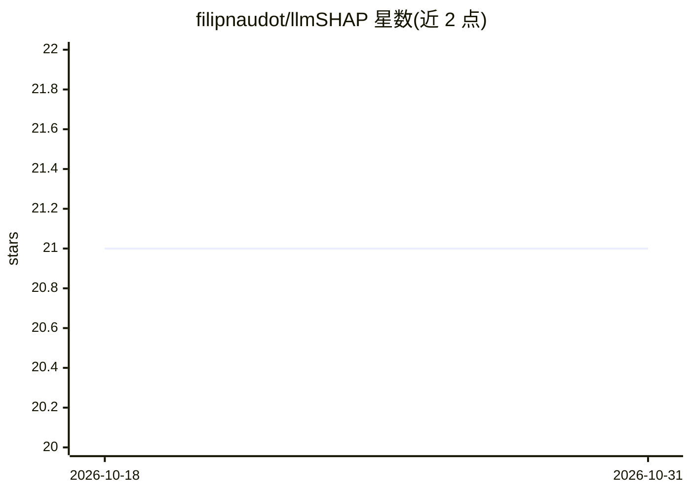

# filipnaudot/llmSHAP

⭐ 21 · Python · MIT · 推送 2026-10-23 · [GitHub](https://github.com/filipnaudot/llmSHAP) · [官网](https://filipnaudot.github.io/llmSHAP/) · 个人维护

**用 Shapley 值解释 LLM 输出归因的多线程框架**

Python 可解释性框架，基于 Shapley 值计算 LLM 输出中各输入成分（token/句子/chunk、图像）的贡献度。提供多线程并行（可选 num_threads）、模块化架构、SlidingWindow/Monte Carlo/Counterfactual 三种启发式、跨联盟缓存与永久上下文固定（permanent_keys）。输出相似度度量可插拔：TF-IDF 或嵌入余弦相似度，嵌入后端支持 OpenAI 兼容 API 端点或本地 sentence-transformers。面向需要对 LLM 输入做归因分析的开发者，PyPI 提供 llmshap[all] 安装，含文档、教程与单元测试。

## 筛选速览

| 维度 | 判定 | 备注 |
|---|---|---|
| AI 角色 | `ai-ecosystem` | LLM/agent 周边工具 |
| 许可风险 | `permissive` | MIT |
| 部署形态 | `library` | 以包/库形式分发 |
| 模型依赖 | — | README 未给出锁定关系 |
| 硬件要求 | — | 无带数字的原话,不猜 |
| 安装摩擦 | `low` | 无编译、无系统依赖或容器化 |
| 成熟度 | — | 结构信号不足 |

## 能力要点

- Shapley 值归因支持文本与图像（多模态）
- 多线程与跨联盟缓存，三种启发式（SlidingWindow/Monte Carlo/Counterfactual）
- 可插拔相似度度量：TF-IDF 或嵌入余弦（OpenAI API / 本地 sentence-transformers 后端）
- permanent_keys 固定始终参与计算的上下文键

## 适用场景

- 分析提示中各部分对 LLM 输出的贡献占比
- 对多模态输入做图像级归因
- 在评测或监控流程中量化输入成分影响

## 场景标签

`LLM 可观测性` · 领域:评测与运维

## 证据(README 行号)

> L7: A multi-threaded explainability framework using Shapley values for LLM-based outputs.
> L58: `EmbeddingCosineSimilarity` measures semantic similarity between outputs using embeddings.

## 星数曲线

2026-10-18 21 → 2026-10-31 21（+0）

---
*卡片 v1 · prompt 1.4 · 生成 2026-10-28 · 置信度 high · 依据 README sha `aeb271b27a29` · [字段定义](../../DATASET.md)*
